# SPECIMEN51: Cyberphysical Systems

IDE Cyber Physical Systems, Group 11  
Team Members: _(add names)_

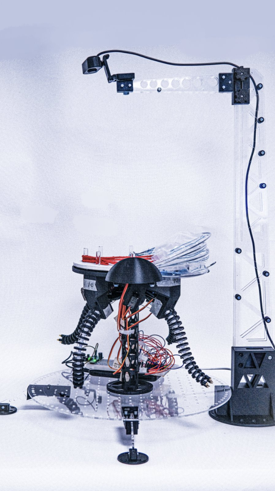

# Overview

<!-- TODO (team): one or two sentences in your own words on where the idea came from. -->

SPECIMEN51 is a soft robot shaped like a jellyfish. Four soft tentacles hang under a round black body, and a clear film hood on top folds open and closed like the hood of a baby stroller. While the hood is open, a visitor winds red yarn round the pegs on the white disc to make a shape. A camera above recognises the shape, the hood closes, and the tentacles play the dance that belongs to that shape.

| | |
| --- | --- |
|  |  |

The whole exhibit is about 66 cm high and 53 cm wide at the feet. The robot body is Ø225 mm and hangs 23 cm above a Ø388 mm clear acrylic deck. A webcam on a mast at the back looks down on the disc from about 40–50 cm above the deck.

We kept the look plain so that the tentacles and the hood get the attention: black PLA, clear acrylic, a white disc and red yarn. The display stand is built like a small operating table, with splayed legs and a triangle-truss mast.

| | |
| --- | --- |
|  |  |

# Design

The plastic parts are printed on a Bambu P1S or laser-cut. The rest is bought (steel wire, acrylic rod, film, yarn, fishing line), and everything is put together with M3/M4 screws. The four tentacle modules are identical, so a broken one can be swapped.

## Assembly Drawings

The whole exhibit goes together in 15 steps: the stand in steps 1–5, the robot in steps 6–9, the jellyfish top in steps 10–14, and step 15 sets the camera height. New parts in each step are grey. Part codes: A = acrylic, P = printed stand parts, R = robot, T = top. All four sheets are also in one PDF: [TentacleJellyfish_WholeExhibit_15steps.pdf](images/assembly/TentacleJellyfish_WholeExhibit_15steps.pdf).

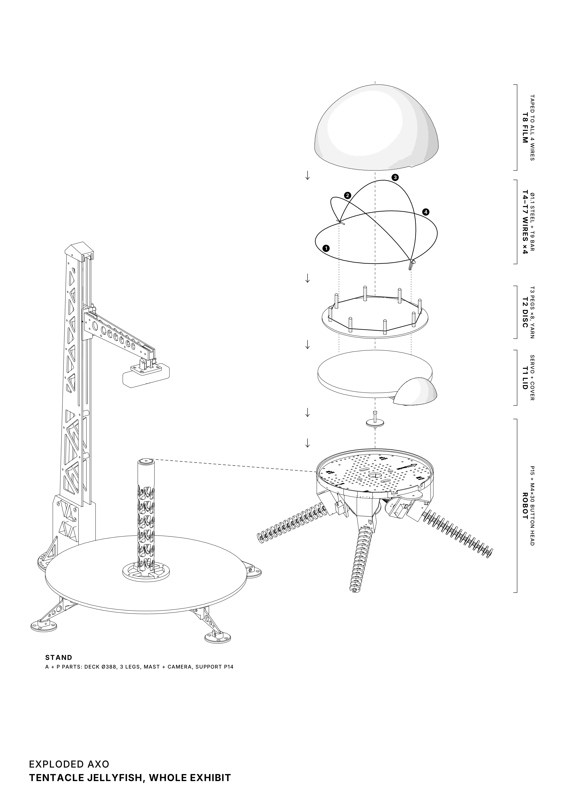
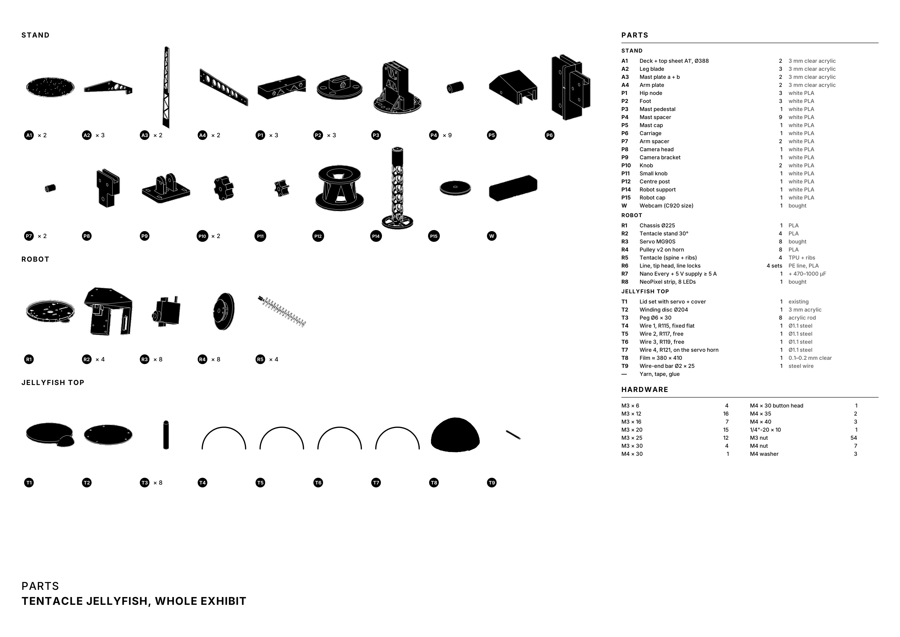
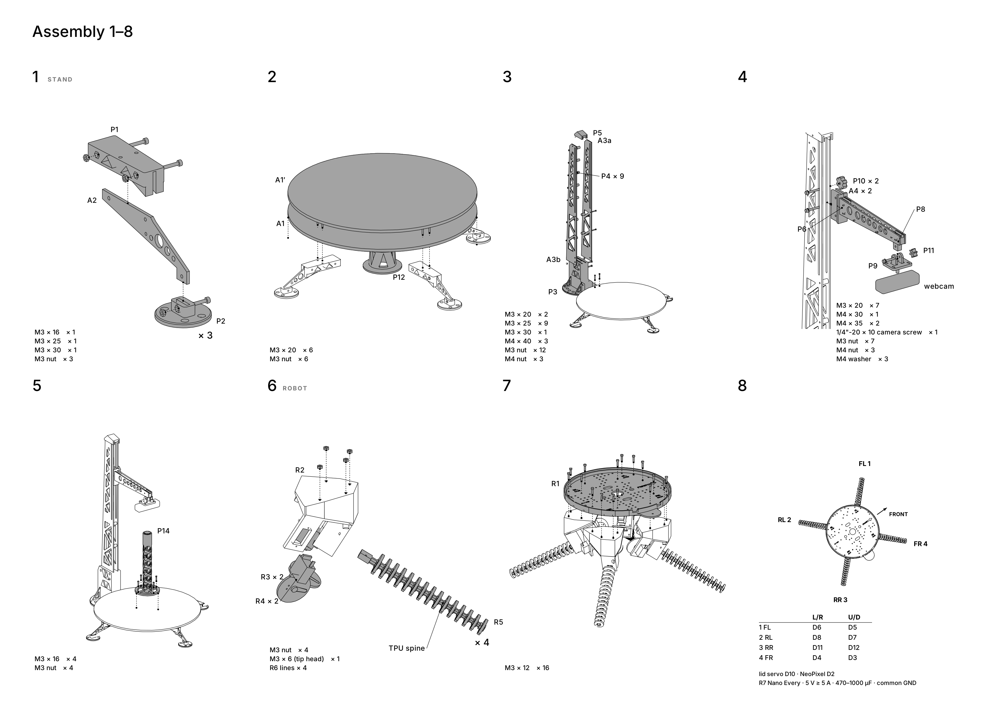
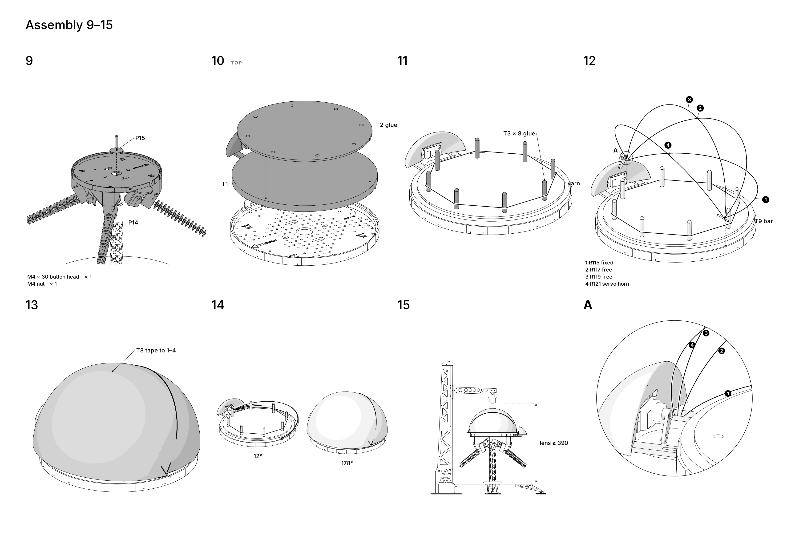

## Files to Print and Cut

| Part | File in `cad/` |
| --- | --- |
| Lid ring (Ø224) | `super ring.stl` |
| Lid servo cover (half) | `servo cover half.stl` |
| Wire holder on the lid servo horn | `servo horn wire holder v2.stl` |
| Lid servo rail (laser-cut) | `servo attachment rail.dxf` |
| Lid and motor, full assembly | `lid motor assembly.step` |

_(add the print and laser-cut files for the tentacles, stands, chassis and display stand)_

Print settings: PLA 0.2 mm, 3 walls, 15 % infill, no supports. TPU: dry the filament, print slowly (at most 2–2.5 mm³/s), 4 walls, 100 % infill, lying flat.

# Mechanisms

## Tentacle

Each tentacle is driven by four lines (tendons) and two servos.

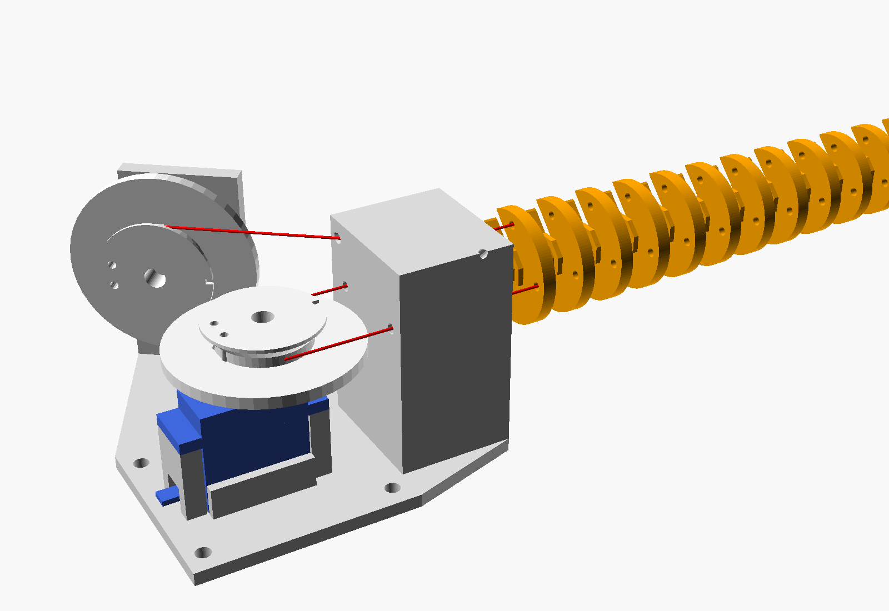

- **Soft spine:** TPU 90A, about 150 mm of bending length, an octagon 7 mm across at the root and 5 mm at the tip. Thin ring slits between the ribs make it soft enough to bend.
- **Ribs:** 15 rigid discs, Ø26 mm at the root to Ø20 mm at the tip, 10 mm apart. Each has four line holes on a cross.
- **Lines:** four fishing lines (up, down, left, right). They run through the rib holes and are clamped at the tip by a small tip head with one M3 × 6 screw.
- **Pulleys:** one pulley (12 mm groove radius) on each servo horn. One servo pulls the left and right lines, the other the up and down lines: one line shortens while the other lengthens, so the tentacle bends. Moving both servos bends it in any direction.

| | |
| --- | --- |
| 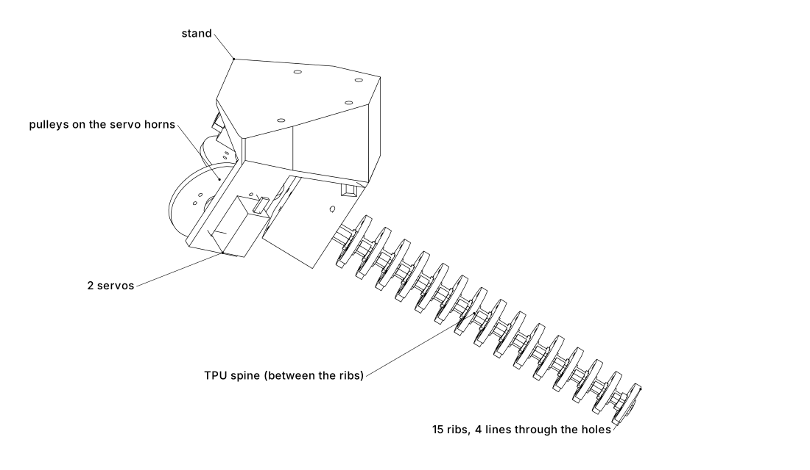 | 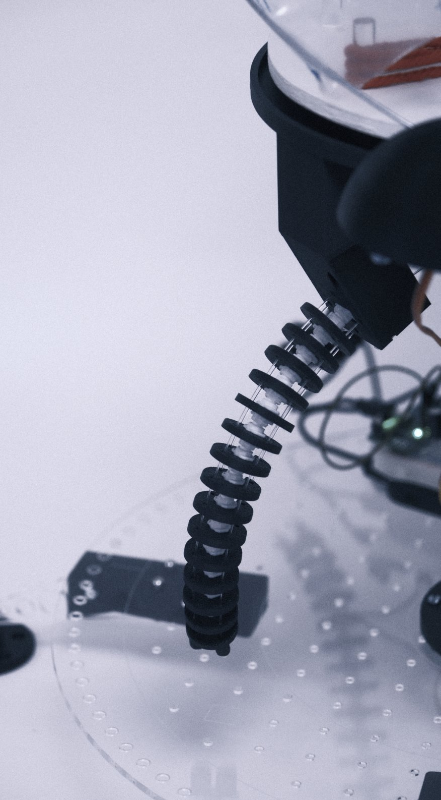 |

## Body and Support Structure

| | |
| --- | --- |
| 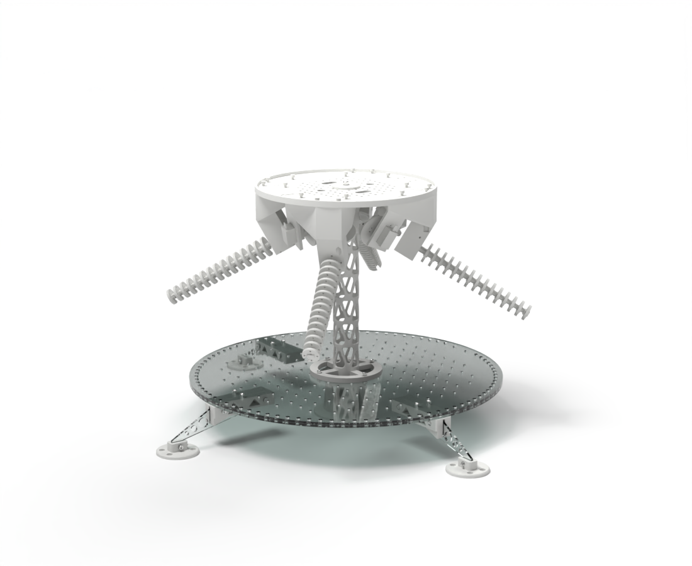 | 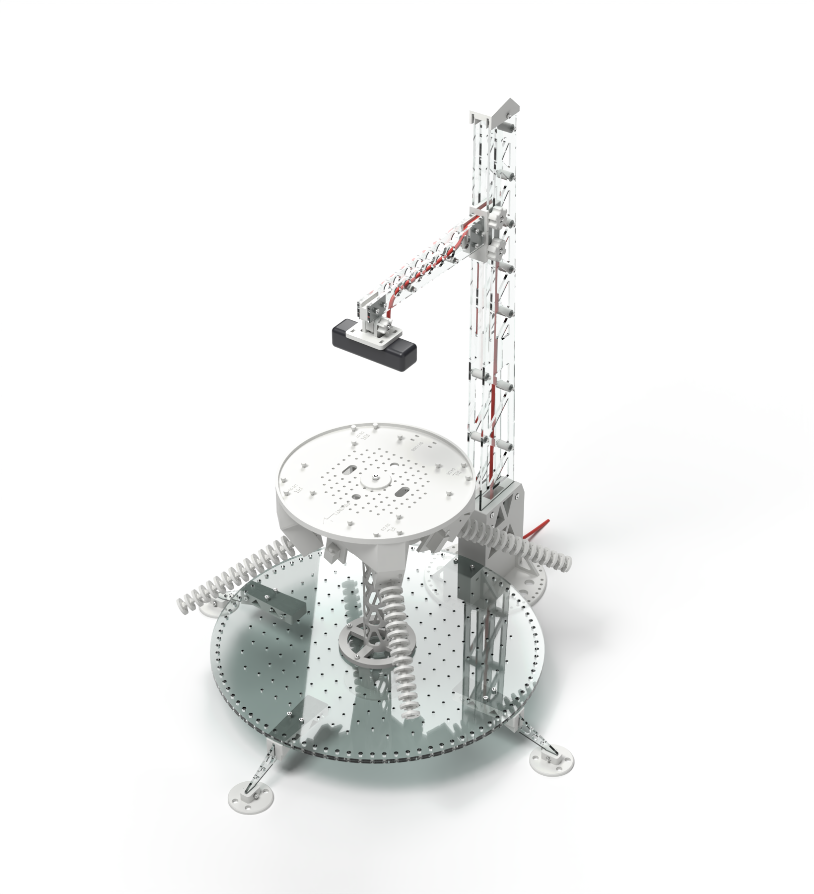 |

- **Stands:** four printed stands hang under the body. Each holds its two servos and points its tentacle 30° down.
- **Chassis:** a printed Ø225 mm plate with a lip, M3 holes on a 10 mm grid, and cable holes. The lid sits on a 3 mm ledge inside the lip. One handle at the side sits under the lid servo's cover.
- **Robot support:** a thin perforated tube (P14) holds the robot in the air in the middle of the deck, so the tentacles can move freely. A cap (P15) and one M4 × 30 **button head** screw lock it. A socket head would touch the lid.
- **Display stand:** a Ø388 mm deck of two 3 mm clear acrylic sheets on three splayed legs. A mast carries a sliding arm with the webcam. The arm slides from 250 to 500 mm above the deck. Set the lens to 390–500 mm: below 390 mm the closed hood blocks the camera.

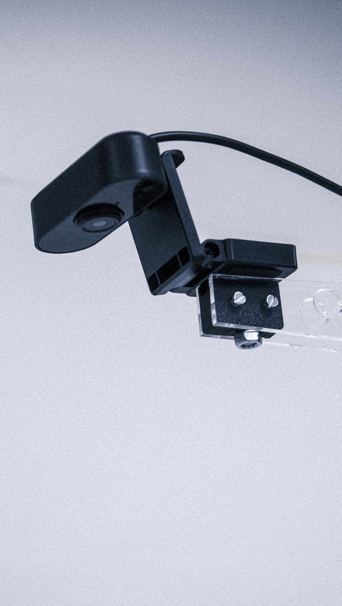

## Jellyfish Top

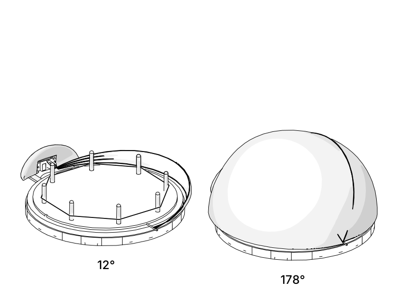

- **Lid:** the lid ring with the lid servo and its quarter-sphere cover. It sits on the chassis.
- **Winding disc and pegs:** a white disc with eight clear acrylic pegs on one ring. The visitor winds the red yarn round the pegs.
- **Four wires:** Ø1.1 mm steel wires, each bent into a half circle (R 115, 117, 119 and 121 mm), all turning about the same hinge axis across the lid. Wire 1 is fixed flat at the back. Wires 2 and 3 can turn freely and are moved only by the film. Wire 4 (the outermost) is hooked into the servo horn. On the side opposite the servo, all four wires hook round a short steel bar (a twisted piece of steel wire) that sticks out of the lid edge.
- **Film:** a clear film (about 380 × 410 mm) taped along all four wires. When the servo turns wire 4 from back to front, it pulls wires 2 and 3 along and the film unfolds into a closed hood.

| | |
| --- | --- |
| 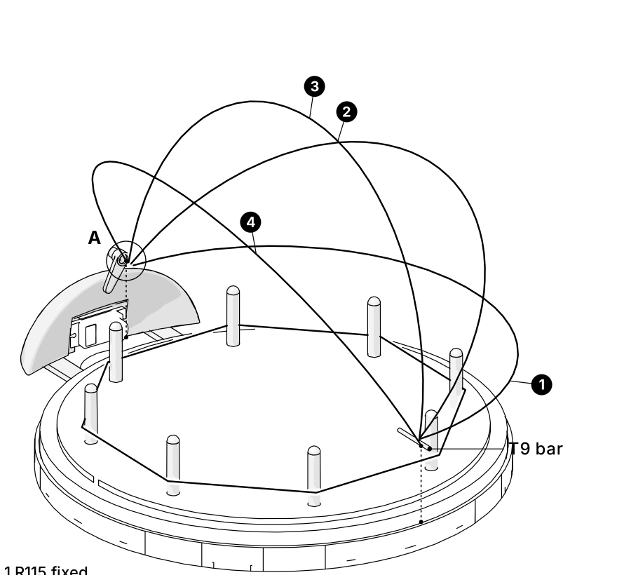 | 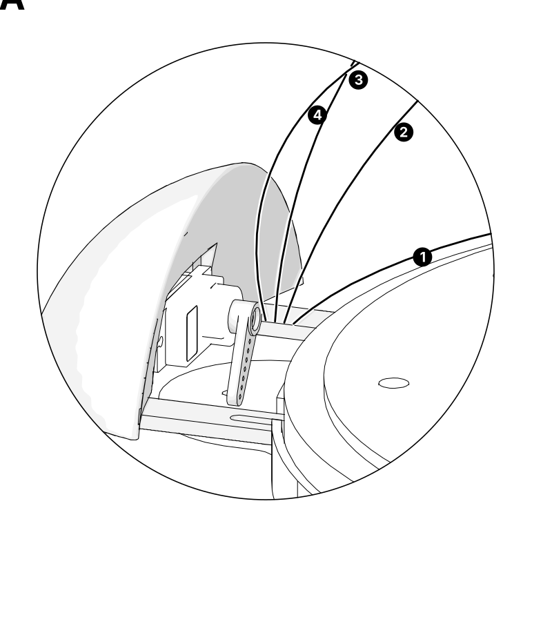 |

# Processing

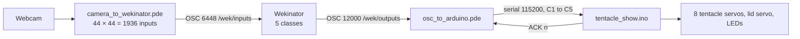

Two Processing programs connect the camera, Wekinator and the Arduino, in the same way as our course robot arm project.

## `Processing_camera/camera_to_wekinator.pde`

- Opens the external webcam at 1280 × 720 through a GStreamer pipeline (`avfvideosrc`, which works on macOS).
- Crops the middle square of the image and keeps only the circle inside it, so people and hands around the robot do not change the result.
- Samples a 44 × 44 grid and sends the brightness of each point (0 to 1, black outside the circle), 1936 values in total, to Wekinator on port 6448 every 3rd frame.
- The window shows the round camera image, the 44 × 44 feature map and how many frames were sent. Its class box stays at "WAITING FOR WEKINATOR" for now (see Next steps); the class is shown in `osc_to_arduino` instead.

## `Processing_osc_to_arduino/osc_to_arduino.pde`

- Listens for `/wek/outputs` on port 12000 and rounds the value to a class from 1 to 5.
- A class must stay the same for 200 ms before it is sent, so a flickering prediction is ignored.
- Sends the class to the Arduino as a line of text (`C3`) at 115200 baud: once when it changes, then again every second in case the Arduino restarts.
- The Arduino answers `ACK 3`. The window has four boxes: what Wekinator sends, the stable class, the class sent, and the class the Arduino confirmed. This makes it easy to see where the chain stops.
- Finds the Arduino port by name (`PORT_HINT = "usbmodem"` on a Mac; on Windows use e.g. `"COM3"`) and reconnects by itself.

## `arduino/tentacle_show.ino`

The Arduino repeats three phases:

| Phase | Time | What happens |
| --- | --- | --- |
| 0 Lid | 25 s | The lid opens in 3 s and stays open while a visitor winds or changes the shape. 2 s before the lid starts to close, the Arduino picks the latest class. The lid then closes in 3 s. |
| 1 Rest | 5 s | All tentacles straight, lid closed. |
| 2 Dance | 15 s | The tentacles play the dance for the picked class. |

Each phase change starts a short blue light wave along the LED strip. A class that arrives after the pick waits for the next round, so the closing lid cannot change the result. The Arduino also accepts a single digit (`3`) typed in the Serial Monitor (115200 baud, line ending "Newline"), which is useful for testing without Wekinator.

`arduino/tentacle_animations_new_copy_20261111020022.ino` is an earlier version (9600 baud, lid servo on D10, no separate lid and rest times).

## Instructions for How to Run

Libraries: Processing **Video** (with GStreamer) and **oscP5**; Arduino **Servo** and **Adafruit NeoPixel**.

1. Upload `arduino/tentacle_show.ino` and close the Serial Monitor.
2. Run `Processing_osc_to_arduino/osc_to_arduino.pde`. Check that the "Sent" box says "serial OK". If not, set `PORT_HINT` to your Arduino port.
3. Run `Processing_camera/camera_to_wekinator.pde`. The yarn shape must be inside the round image.
4. Open `Wekinator/CPS_Wekinator.wekproj` (1936 inputs on port 6448, 1 classifier output with 5 classes, sent to port 12000). Record examples for each shape, train, then run.
5. Watch the four boxes in `osc_to_arduino`: when the "Arduino" box says "confirmed", the class has arrived.

# Wekinator

## Settings

- **Inputs:** 1936 values from `camera_to_wekinator.pde` (the 44 × 44 brightness grid, black outside the circle).
- **Outputs:** 1 output, classifier, 5 classes.
- **Training:** _(add the model type, how many examples per class, and how you recorded them)_
- The repository holds the project settings (`inputConfig.xml`, `outputConfig.xml`, `CPS_Wekinator.wekproj`). _(add the trained model, or note that it is retrained before each demo)_

## Inputs and Outputs

The input is not a hand gesture but an object: red yarn wound round the pegs into a shape. A shape is easy to make and to change, and the red yarn shows up well against the white disc. MODE_0 in the instruction manual is the rest position, with all tentacles straight.

| Class | Shape | Dance |
| --- | --- | --- |
| 1 | Triangle | Up/down wave: the four tentacles rise and fall one after another |
| 2 | Square | Left/right wave |
| 3 | Circle | Diagonal twitch: one diagonal pair twitches, and the pairs swap every 2 s |
| 4 | Long thin loop | Cross-step dance: one pair sways left and right in mirror, the other pair nods up and down in mirror |
| 5 | Half circle | Relay circle: one tentacle at a time draws a big circle, then passes it on |

# Debugging

Use the tests below to find where the chain stops working. Uploading a test sketch replaces the main tentacle sketch, so upload `tentacle_show.ino` again afterwards.

| Test | What it tests |
| --- | --- |
| [debug/CPS_Debug_Arduino_servo_test](debug/CPS_Debug_Arduino_servo_test/CPS_Debug_Arduino_servo_test.ino) with [CPS_Debug servo_test.html](debug/CPS_Debug%20servo_test.html) | Each of the 8 tentacle servos turns to 180°, then to 0°, and stops there, one at a time, from a button in the web page (Chrome or Edge, Web Serial, 9600 baud). Loosen the lines first, because 0–180° is far more than the tentacles need. |
| Serial Monitor with `tentacle_show.ino` (115200 baud) | Set the line ending to "Newline" and type `1`–`5`. The Arduino answers `ACK n` (and `class:n` when the class changes). If you type it before the pick in the lid phase, that dance plays after the rest phase; otherwise one round later. |
| The four boxes in `osc_to_arduino.pde` | Wekinator → stable → sent → confirmed by the Arduino. |
| The feature map in `camera_to_wekinator.pde` | What Wekinator actually sees. |

## Decision tree

Use the matching letter in the issue tables.

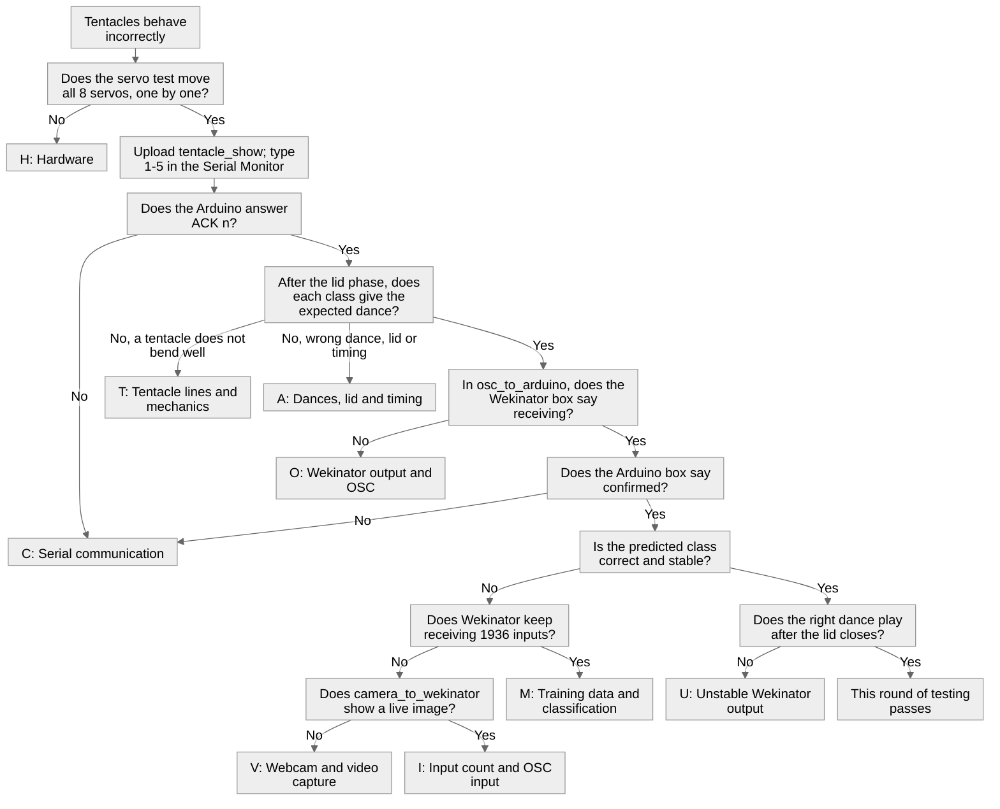

The class is picked 20 s into the lid phase, 2 s before the lid starts to close, and danced after the 5 s rest. A shape changed after the pick waits for the next round (about 45 s). If Wekinator shows the right class but the Arduino keeps playing dance 1, the class never reached the Arduino (see C).

## Tentacle issue table

| Code | Problem | What to check |
| --- | --- | --- |
| H (Hardware) | A servo does not move | Check its signal wire is on the pin given in `LR_pins` / `UD_pins`. Test one servo at a time. |
| T (Tentacle) | A tentacle is bent at 90 | Turn the servo horn by one tooth so the tentacle is straight at 90. |
|  | A line is loose, slips, or is pulled too tight | Check the line locks on the pulley and the tip head. |
|  | A servo hums at the end of a move | The line is too tight. Loosen it at the tip head. |
|  | The tentacle hardly bends | Use the softer spine (slit C or D) and the 12 mm pulley (v3). |
| C (Communication) | The "Sent" box says "serial closed" | Set `PORT_HINT` in `osc_to_arduino.pde` to your Arduino port. Close the Serial Monitor and the servo test page, which also use the port. |
|  | No `ACK` comes back | Use 115200 on both sides. Check that `tentacle_show.ino` (not the servo test) is uploaded. |
|  | The Arduino was restarted | `osc_to_arduino` sends the class again within 1 s and after `READY`. Wait a moment. |
| A (Dances, lid and timing) | The wrong tentacle moves | Check `LR_pins` and `UD_pins` against where each servo is plugged in. |
|  | Up/down and left/right are swapped | Swap that tentacle's numbers in `LR_pins` and `UD_pins`. |
|  | The lid opens the wrong way or too far | Change `head_closed` and `head_open`. |
|  | Not enough time to change the shape, or waiting too long | Change `head_time`, `head_move_time`, `rest_time` and `phase_time`. Keep `head_time` at least 2 × `head_move_time` + 2000, so the class is picked while the lid is fully open. |
|  | The dance is too fast or too big | Change the period (ms) or the number in front of `wave(...)` (degrees) in that dance. |

## Input issue table

| Code | Problem | What to check |
| --- | --- | --- |
| V (Video to Wekinator) | The camera does not start | Check the Video library and GStreamer. `avfvideosrc device-index=0` is for macOS; change `device-index` to pick another camera, or use the default capture on Windows. Allow camera access and close other camera apps. |
|  | The shape is not inside the round image | Move the camera arm or the robot so the disc fills the circle. |
| I (Wekinator input) | Wekinator expects the wrong number of inputs | Set Wekinator to 1936 inputs to match `gridSize = 44`. |
|  | Inputs go to the wrong place | Check the Wekinator IP (127.0.0.1) and port 6448. |
| M (Machine learning) | Training examples are missing or have wrong labels | Add enough examples for all five classes. |
|  | Two shapes look too similar | Make the five shapes very different. Keep the light and the camera fixed. |
|  | The camera or robot moved after training | Keep the same setup. Retrain after changes. |
| O (OSC output) | The model is not trained or not running | Train the model, start it running, and check the predicted class. |
|  | The box says "no OSC on 12000" | Check the output IP, port 12000 and `/wek/outputs`. Close other apps using port 12000. |
|  | "Other OSC address received" appears | Wekinator sends to a different message name. Set it to `/wek/outputs`. |
| U (Unstable output) | The class keeps changing around the pick time | Check that the class stays steady. Add more examples and retrain. |

# Rejected Ideas

- **Silicone pneumatic tentacles:** they need pumps and valves that do not fit the 5 V kit. Line-driven tentacles can be printed and built quickly.
- **Two lines per tentacle:** two lines only bend a tentacle in one plane. Four lines and two servos let it bend up, down, left and right.
- **Solid TPU spine:** too stiff. A hollow spine was still too stiff, so the final spine has thin ring slits between the ribs.

  

- **Wooden disc:** replaced by a printed chassis that is lighter and has holes for the electronics and the lid.
- **One tentacle circling per class:** our first Wekinator version. The final version adds the lid phase, five dances and LEDs.
- **All eight servos moving at once:** the supply could not run them. The dances now move no more than four servos at a time, apart from short moments.

# Next steps

- The model uses raw brightness values, so it is sensitive to light, shadows and the position of the shape. A fixed light and a black-and-white threshold would make it more robust.
- A shape changed after the pick waits a whole round, so its dance can start almost a minute later.
- The camera window listens on port 12001 to show the class, but nothing sends to that port yet, so it keeps showing "WAITING FOR WEKINATOR". `osc_to_arduino` could forward each class to 12001.
- The MG90S servos are close to their torque limit when bending the tentacles up, and the lines stretch over time and need re-tensioning at the tip head.
- The mast can sway a little. Thicker acrylic would be stiffer.
- The Ø388 mm deck is wider than the 370 mm storage box, so it does not fit flat in the box. A smaller deck would.
- The film pleats between the wires and can catch when the hood closes.
- The LEDs could react to the class, and a sensor in the lid could start a round when a shape is placed.

---

Disclaimer on AI usage: _(team: check and edit)_ The CAD models, the assembly drawings and parts of the Arduino and Processing code were made with help from Anthropic Claude. This README was drafted with Claude and edited by the team.  
Cyber Physical Systems, Group 11: _(names)_
