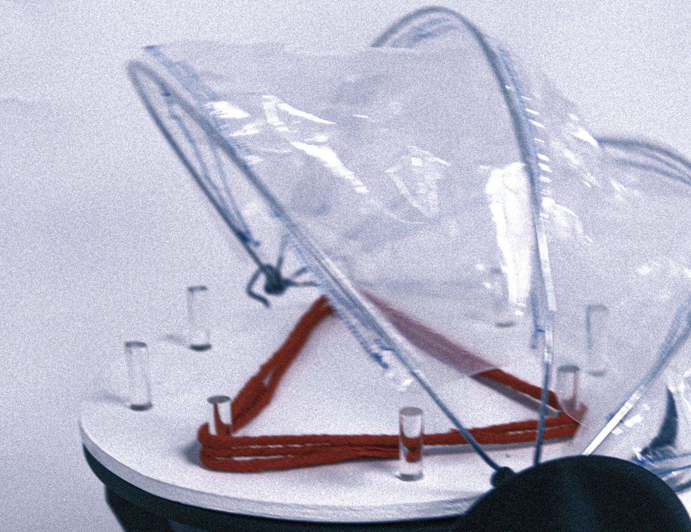
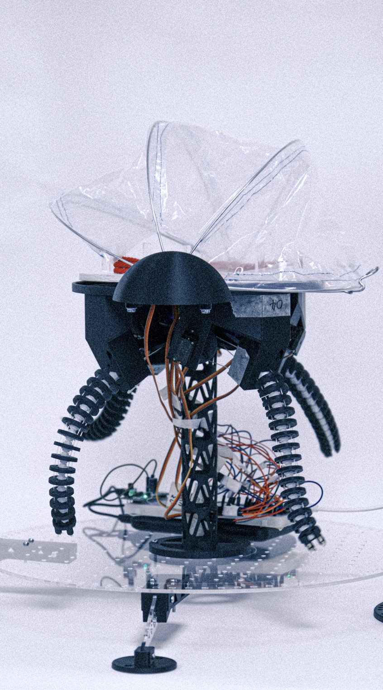
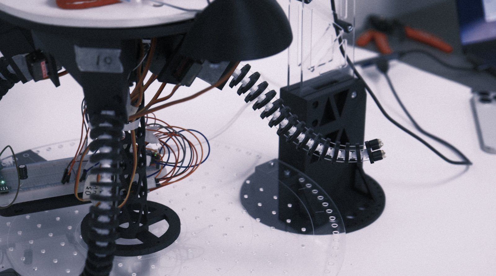
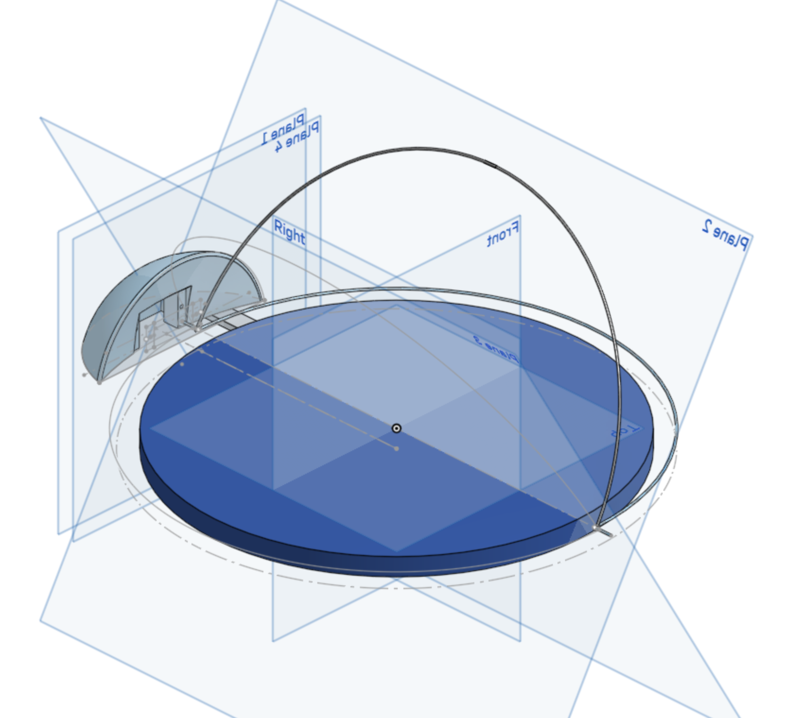
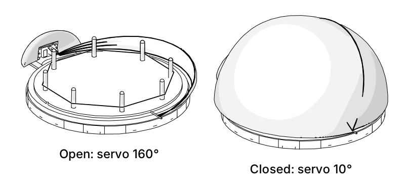
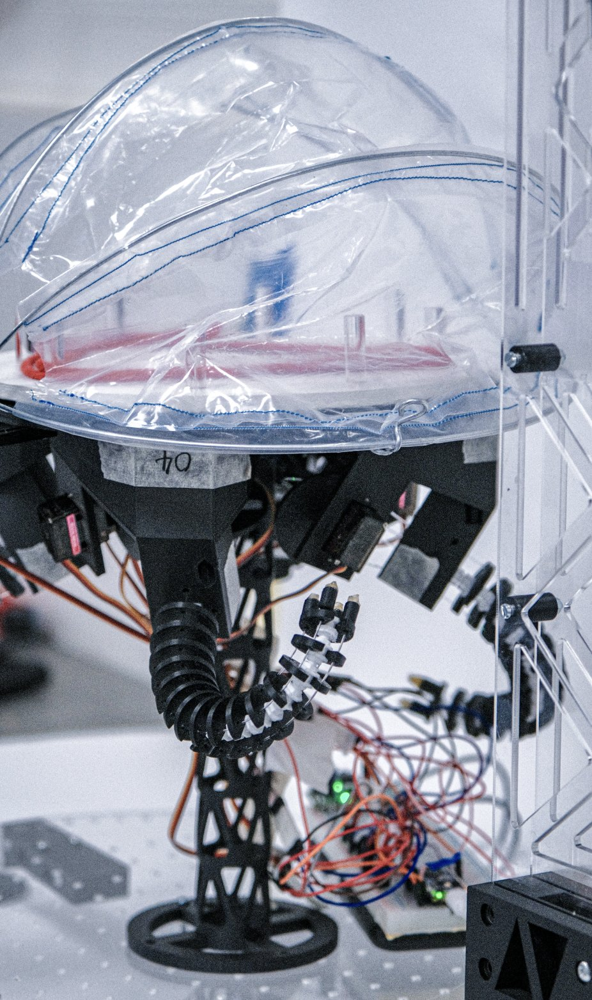
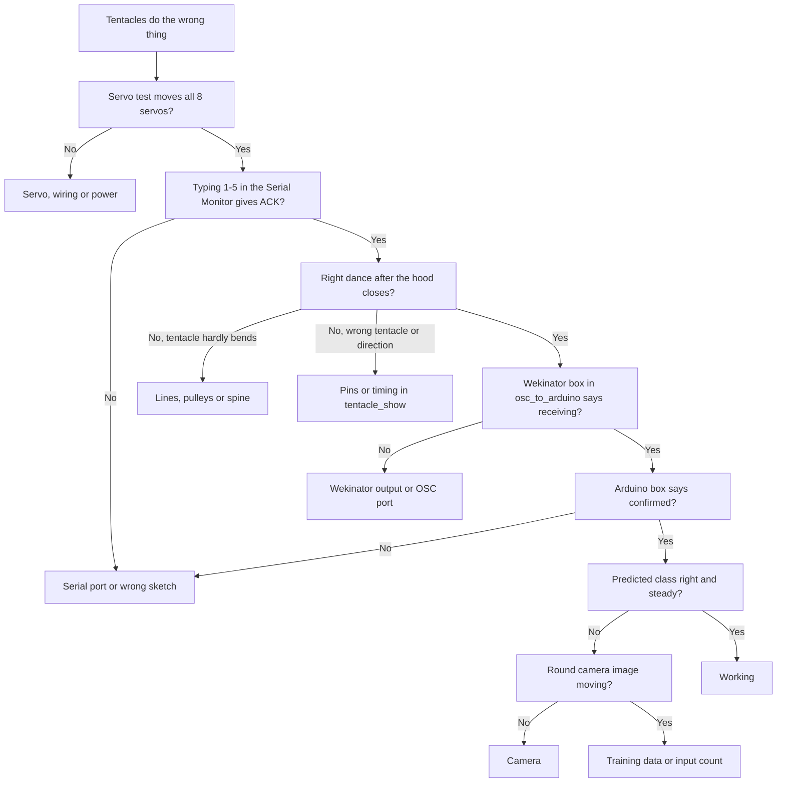

# SPECIMEN51: Cyberphysical Systems

IDE Cyber Physical Systems, Group 11  
Team Members: Ismail Kale, Siyu Sun, Shuheng Wang

# Overview

SPECIMEN51 is a soft jellyfish robot. Four tentacles hang from a round black body, and on top there is a clear hood that folds open and shut like the hood of a pram. While the hood is open, you wind a piece of red yarn around the pegs on the white disc to make a shape. A webcam above the robot looks at the shape and Wekinator decides which of our five shapes it is. Then the hood closes and the tentacles do the dance that belongs to that shape. After the dance the hood opens again and the next person can wind something new.

We wanted an input that you make with your hands. The yarn stays on the disc, so the camera can look at it for as long as the hood is open, and it takes only a few seconds to wind a new shape or change an old one. Red yarn on a white disc also gives the camera a strong contrast to work with.

The instruction manual shows the five shapes (MODE_1 to MODE_5) and the dance each one triggers. MODE_0 is the rest pose with all tentacles straight.

| Square on the pegs | Triangle under the open hood |
| --- | --- |
|  |  |

One round takes 45 seconds and then repeats: the hood is open for 25 s, the robot rests for 5 s, and the dance lasts 15 s. The shape is read 2 s before the hood starts to close, so a shape you finish while the hood is open gets its dance about 10 s later.

The display stand is based on an operating table, with splayed legs and a truss mast for the camera, so the jellyfish sits on it like a specimen being examined. The robot is printed in black PLA, and the stand and hood are clear acrylic and film, so the black body and tentacles stand out. Set up, the exhibit is about 66 cm tall and 53 cm wide at the feet, and the robot body hangs 23 cm above the deck.

| Running the software next to the exhibit | Front view with the hood open |
| --- | --- |
|  |  |

# Design

## From the robot arm to tentacles

The brief starts from the course robot arm. We kept the control chain we had built for the arm exercise (camera, Wekinator, Processing, Arduino, servos), but a jellyfish does not move like a rigid arm, so we built a new mechanism instead of modifying the arm. The arm moves four servos, one per joint, to fixed positions. SPECIMEN51 has nine servos: two for each tentacle and one for the hood. Each tentacle bends along its whole length and in any direction, so the dances can be waves and circles instead of poses.

## Assembly drawings

We drew the whole exhibit as 15 assembly steps on four sheets. Steps 1-5 are the display stand, 6-9 the robot, 10-14 the hood, and step 15 sets the camera height. On the parts list, A is acrylic, P a printed stand part, R a robot part and T a part of the top. All four sheets are also in one PDF: [SPECIMEN51_assembly.pdf](images/assembly/SPECIMEN51_assembly.pdf).

## Files to print and cut

The `cad/` folder has the lid parts we modelled in Onshape:

| Part | File |
| --- | --- |
| Lid ring, 224 mm | [super ring.stl](cad/super%20ring.stl) |
| Lid servo cover (half) | [servo cover half.stl](cad/servo%20cover%20half.stl) |
| Wire holder on the lid servo horn | [servo horn wire holder v2.stl](cad/servo%20horn%20wire%20holder%20v2.stl) |
| Lid servo rail, laser-cut | [servo attachment rail.dxf](cad/servo%20attachment%20rail.dxf) |
| Lid and servo, whole assembly | [lid motor assembly.step](cad/lid%20motor%20assembly.step) |

Print settings: PLA at 0.2 mm layers, 3 walls, 15% infill, no supports. The tentacle spines are TPU 90A: dry the filament first, print slowly (max 2-2.5 mm3/s), 4 walls, 100% infill, lying flat.

# Mechanisms

## Tentacles

We built and tested one tentacle on its own stand (right in the photo) before making the other three.

Each tentacle is a soft TPU spine with 15 hard ribs on it, 10 mm apart, getting smaller towards the tip (26 mm across at the root, 20 mm at the tip). Four fishing lines run through holes in the ribs at the top, bottom, left and right, and are clamped together at the tip with a small M3 screw. At the root, the left and right lines go round a pulley on one servo, and the up and down lines round a pulley on the other. When a servo turns, one line gets shorter and the opposite one gets longer, so the tentacle curls towards the short side. With both servos moving together the tentacle can bend in any direction, which is how the relay dance draws circles.

Getting the spine soft enough took four iterations. Iteration 1 was solid TPU and hardly bent. Iteration 2 kept the same outside but had closed hollow chambers inside, and it was still too stiff. Iteration 3 has thin ring slits between the ribs that leave only a round core in the middle, and this is the one we use. Iteration 4 has an even thinner core, as a softer option.

The pulleys changed a few times as well. Our MG90S horns have a raised hub, so the first pulley would not sit on them and we remodelled its pocket around the horn. Some servos came with flat horns, so there is a flat version too. After that the tentacle still stopped short of a full bend when the servo reached its end, so we made the groove bigger (radius 10 mm to 12 mm) to pull more line per degree. Knots in the clear fishing line kept slipping, so the line ends are held with small printed beads: the line goes through a tapered hole and a short piece of 1.75 mm filament is pushed in after it as a wedge.

## Body and support

The four tentacle stands are screwed under a printed chassis 225 mm across. Each stand holds its two servos and points its tentacle 30 degrees down. The chassis has a grid of M3 holes, which let us move parts around while building, and holes for the cables. The robot sits on a thin printed tube in the middle of the deck (P14), held by a cap (P15) and one M4x30 screw. It has to be a button head screw, because a socket head touches the lid.

The display stand is two 3 mm clear acrylic discs (388 mm) on three splayed legs with printed joints. A mast at the back carries a sliding arm for the webcam, which can be set from 250 to 500 mm above the deck. Below about 390 mm the closed hood gets in the camera's way, so we keep it higher than that.

## Hood

The lid ring, the cover for the lid servo and the rail it sits on are our own Onshape parts (see `cad/`). On top of the lid is a white disc with eight clear acrylic pegs for the yarn.

The hood is made of four 1.1 mm steel wires, each bent into a half circle of a slightly different size (radius 115, 117, 119 and 121 mm), all turning about the same axis across the lid. The smallest one is fixed lying flat at the back, the two middle ones are loose, and the biggest one is attached to the lid servo horn. On the far side, the wire ends hook round a short twisted piece of steel wire sticking out of the lid. A clear film is fixed along all four wires. When the servo swings the outer wire forward, the film pulls the two loose wires along and unfolds into a closed dome.

# Electronics

# Wekinator

## Input

The input is the yarn shape on the disc, seen from above by the webcam. `camera_to_wekinator.pde` cuts a circle out of the middle of the camera image that just covers the disc and turns everything outside it black, so hands and people walking past do not change the input. It then samples a 44x44 grid of brightness values (1936 inputs, from 0 to 1) and sends them to Wekinator every third frame. For the robot arm we had sent the full 80x80 image (6400 values). Cutting it down to the disc means Wekinator only sees what matters.

## Output

One classifier output with five classes, one for each shape. We used a classifier rather than continuous outputs because each shape should start one whole dance, not a mix of two.

| Class | Shape | Dance |
| --- | --- | --- |
| 1 | Triangle | Up/down wave: each tentacle rises and falls a quarter beat after the one before, so a wave runs round the body |
| 2 | Square | The same wave, but left and right |
| 3 | Circle | Diagonal twitch: two opposite tentacles twitch quickly, and every 2 s the other pair takes over |
| 4 | Long thin loop | Cross-step: one pair sways left and right in mirror while the other pair nods up and down, with a bigger nod every other bar |
| 5 | Half circle | Relay: one tentacle at a time swings round in a circle, then hands over to the next one |

## Training and running the model

1. Start `camera_to_wekinator.pde` and check that the disc fills the round image.
2. In Wekinator, create a project with 1936 inputs on port 6448 (`/wek/inputs`) and one classifier output with 5 classes, sent to port 12000 (`/wek/outputs`). The settings we used are in `Wekinator/` (`CPS_Wekinator.wekproj`, `inputConfig.xml`, `outputConfig.xml`).
3. Wind the first shape, set the output to class 1 and record examples. Move the yarn a little and wind it again between recordings, so the model sees the same shape in slightly different positions.
4. Do the same for classes 2 to 5, then train.
5. Press Run. The predicted class goes to `osc_to_arduino.pde` and from there to the Arduino.

The trained model is not in the repository, only the project settings, so it has to be trained again on a new computer or under different light.

## Improving the model

With more time and resources, the first thing we would add is more varied training data: each shape wound by different people, at different sizes and positions on the pegs, and under the light of every room we show in. We would also record an empty disc and half-finished shapes as a class of their own. At the moment there are only five classes, so an empty disc is always read as one of the shapes. More data would help most with shapes made by people we have never trained on. With a bigger dataset we could also compare Wekinator's classifiers (k-nearest neighbour, decision tree, SVM, neural network) on the same recordings, or train a small convolutional network on the images, which copes better with shifted or rotated shapes.

Some limits would stay. The camera sees only brightness from one angle, so shapes that look alike from above, such as a circle and a rounded square, will always be close. Light changes the raw values, so every new place needs some retraining or a fixed lamp. And because the robot reacts once per round, a better model does not make it react faster.

# Processing

Two Processing sketches sit between the camera, Wekinator and the Arduino, and one Arduino sketch runs the whole robot. They grew out of the code we used for the robot arm (the course video example by Rebecca Fiebrink and Becky Stewart's OSC to Arduino example). The main changes:

| | Robot arm | SPECIMEN51 |
| --- | --- | --- |
| Camera input | 80x80 = 6400 brightness values from a 640x480 image | 44x44 = 1936 values from a circle in the middle of a 1280x720 image, every 3rd frame |
| Wekinator to Arduino | One byte when the class changes, 9600 baud | A text line such as `C3` at 115200 baud, sent only after the class has stayed the same for 200 ms, repeated every second, and confirmed by the Arduino with `ACK 3` |
| Arduino | Four arm servos moved with switch cases and for loops | 8 tentacle servos, the lid servo and 8 LEDs in a 45 s loop of lid, rest and dance phases; the dances are sine waves |

## `Processing_camera/camera_to_wekinator.pde`

Opens the webcam at 1280x720, cuts out the round middle part and sends the 44x44 brightness grid to Wekinator on port 6448. The window shows the round camera image, the 44x44 grid that Wekinator receives, and how many frames have been sent. The camera is opened through GStreamer with `avfvideosrc`, which only works on macOS. The class box in this window stays at "WAITING FOR WEKINATOR", because nothing sends to its port (12001) yet. The class is shown in `osc_to_arduino` instead.

## `Processing_osc_to_arduino/osc_to_arduino.pde`

Listens for `/wek/outputs` on port 12000 and rounds the value to a class from 1 to 5. A class has to stay the same for 200 ms before it is sent, so a prediction that flickers for a frame is ignored. It sends the class as a line of text (`C3`) when it changes, and again every second in case the Arduino has restarted. The Arduino answers `ACK 3`. The four boxes in the window show what Wekinator sends, the stable class, the class that was sent, and the class the Arduino confirmed. The sketch finds the Arduino by part of the port name (`PORT_HINT = "usbmodem"` on a Mac; on Windows use something like `"COM3"`) and reconnects by itself if the cable is pulled out.

## `arduino/tentacle_show.ino`

The Arduino goes round three phases:

| Phase | Length | What happens |
| --- | --- | --- |
| 0 Lid | 25 s | The hood opens over 3 s and stays open so a shape can be wound. 2 s before it starts closing, the Arduino takes the latest class. Then the hood closes over 3 s. |
| 1 Rest | 5 s | All tentacles straight, hood closed. |
| 2 Dance | 15 s | The dance for the class taken in phase 0. |

Each phase change sends a short blue light along the LED strip. A class that arrives after it has been taken waits for the next round, so the closing hood cannot change the dance. Over serial the Arduino prints `READY` at start, `phase:n` at each phase change, `animation:n` when it takes the class, `class:n` when a new class comes in, and `ACK n` for every message. It also accepts a single digit typed into the Serial Monitor, which is handy for testing without Wekinator.

Only this sketch is needed to run the project. `arduino/tentacle_animations_new_copy_20261111020022.ino` is an earlier version that we kept for reference: every phase in it lasts 1 s, the class is used the moment it arrives, the lid is on D10 and it talks at 9600 baud, so it does not work with `osc_to_arduino`.

## How to run (macOS)

1. Install Processing 4 with the Video library (GStreamer) and oscP5, and in the Arduino IDE the Servo and Adafruit NeoPixel libraries. The board is an Arduino Nano Every, which needs the "Arduino megaAVR Boards" package.
2. Open `arduino/tentacle_show.ino`. The Arduino IDE asks to move it into a folder of its own; say yes. Upload it and close the Serial Monitor.
3. Run `Processing_osc_to_arduino/osc_to_arduino.pde`. The "Sent" box should say "serial OK". If it doesn't, change `PORT_HINT` to your Arduino port.
4. Run `Processing_camera/camera_to_wekinator.pde` and check that the yarn shape is inside the round image.
5. Open `Wekinator/CPS_Wekinator.wekproj`, train it (see above) and press Run.
6. When the "Arduino" box in `osc_to_arduino` says "confirmed", the class has reached the robot.

The two sketch folders have different names from the .pde files inside them. Processing 4 reads `sketch.properties` in each folder to find the right file.

# Debugging

Uploading a test sketch replaces the main sketch, so upload `tentacle_show.ino` again after testing.

| Test | What it tells you |
| --- | --- |
| [CPS_Debug_Arduino_servo_test.ino](debug/CPS_Debug_Arduino_servo_test/CPS_Debug_Arduino_servo_test.ino) with [CPS_Debug servo_test.html](debug/CPS_Debug%20servo_test.html) | Whether each of the 8 tentacle servos works. Open the page in Chrome or Edge (it uses Web Serial at 9600 baud) and press a button: that servo turns to 180, then to 0, then switches off. Loosen the lines first, because this is a much bigger swing than the tentacles can take. The lid servo is not part of this test. |
| Serial Monitor with `tentacle_show.ino` (115200, "Newline") | Whether the Arduino gets classes. Type 1 to 5 and look for `ACK n`. |
| The four boxes in `osc_to_arduino.pde` | Where the chain stops: Wekinator, stable class, sent, confirmed by the Arduino. |
| The 44x44 grid in `camera_to_wekinator.pde` | What Wekinator actually sees. |

## Decision tree

## Problems and fixes

| Problem | Cause | What fixed it |
| --- | --- | --- |
| Pulley would not sit on the servo horn | Our MG90S horns have a raised hub | Remodelled the pulley pocket around the real horn, plus a version for flat horns |
| Line ends slipped | Knots don't hold in clear fishing line | Printed beads with a tapered hole and a piece of filament as a wedge |
| Tentacle stopped short of a full bend | Not enough line per degree of servo turn | Pulley groove from 10 to 12 mm radius |
| Tentacle hardly bent at all | Spine too stiff | Ring slits in the spine (iteration 3) |
| Servos twitched or stopped when many moved | Not enough current for all servos at once | The dances move at most four tentacle servos at a time. Check the servo supply and the shared ground. |
| LED strip clashing with a tentacle servo | Both were set to D11 in an early sketch | LED strip moved to D2 |
| Tentacle bent when it should be straight | Horn put on one tooth off | Take the horn off and turn it by one tooth so the tentacle is straight at 90 |
| "Sent" box says "serial closed" | Serial Monitor or the servo test page still has the port open | Close them, or set `PORT_HINT` |
| No `ACK` | Wrong sketch on the board (the servo test or the old 9600 baud sketch) | Upload `tentacle_show.ino` |
| Prediction jumps between two classes | Two shapes look alike, or too few examples | 200 ms filter in `osc_to_arduino`; record more examples |
| Dance doesn't match the shape on the disc | The shape was changed after the class was taken | Wait for the next round |
| Camera window class box says "WAITING FOR WEKINATOR" | Nothing sends to port 12001 | Expected; read the class in `osc_to_arduino` |

# Rejected Ideas

- **A robot that crawls on its tentacles.** This was our first plan. The MG90S servos were already near their limit just bending a tentacle upwards, so we gave up on walking and put the robot on a support where only the tentacles move.
- **Silicone tentacles driven by air.** These need pumps and valves that are not in the 5 V kit. Tentacles pulled by lines could be printed and built in a few days.
- **Two lines per tentacle.** Our first tentacle design only swept left and right. With two lines a tentacle bends in one plane only, so we went to four lines and two servos.
- **A wooden disc as the body.** It was replaced by a printed chassis with a hole grid, so the stands, cables and lid could be mounted without drilling.
- **Switching the dance as soon as the class changes.** In our earlier sketch every phase lasted 1 s and a new class was used straight away, so a hand or the closing hood in front of the camera could change the dance. Now the class is taken once per round, while the hood is still open.

# Next steps

- The model works on raw brightness, so light, shadows and the position of the shape all affect it. A fixed lamp and a black-and-white threshold in `camera_to_wekinator` would make it more robust.
- If the shape is changed after the class has been taken, its dance only comes a round later.
- `osc_to_arduino` could forward each class to port 12001, so the camera window shows it too.
- The MG90S servos are near their limit when bending a tentacle upwards, and the lines stretch over time and need tightening again at the tip.
- The mast sways a little; thicker acrylic would be stiffer.
- The deck is 388 mm across, a bit more than the 370 mm width of the storage box. A deck of about 360 mm would pack flat.
- The film pleats between the wires and can catch when the hood closes.
- The LEDs could change with the class, and a test button for the lid servo would be useful in the servo test page.

# References

- Fiebrink, R. Wekinator. http://www.wekinator.org/
- IDE-GID-Cyberphysical-Systems, de-arm (course robot arm and example code). https://github.com/IDE-GID-Cyberphysical-Systems/de-arm
- Course example code: the Processing video input example by Rebecca Fiebrink and the OSC to Arduino example by Becky Stewart (2022), which our two Processing sketches started from.
- Processing Foundation. Processing 4 and the Video library (GStreamer). https://processing.org/
- Schlegel, A. oscP5. https://sojamo.de/libraries/oscP5/
- Arduino. Servo library. https://docs.arduino.cc/libraries/servo/
- Adafruit. Adafruit NeoPixel library. https://github.com/adafruit/Adafruit_NeoPixel
- Web Serial API (used by the servo test page). https://developer.mozilla.org/en-US/docs/Web/API/Web_Serial_API
