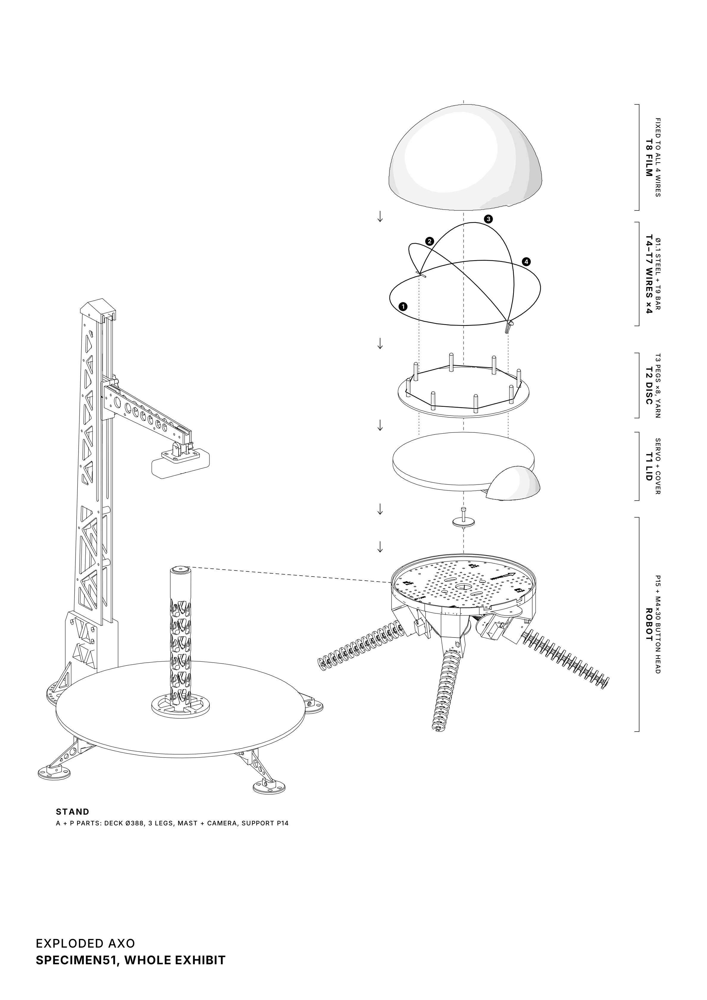
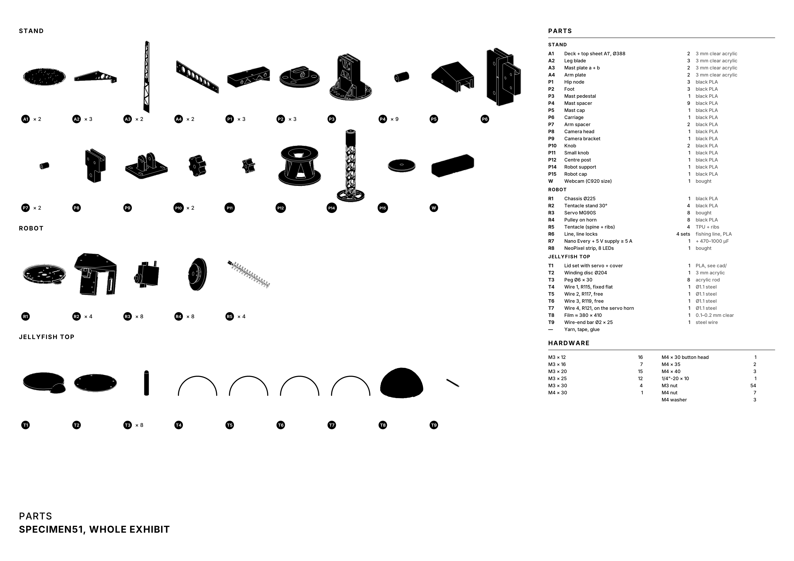
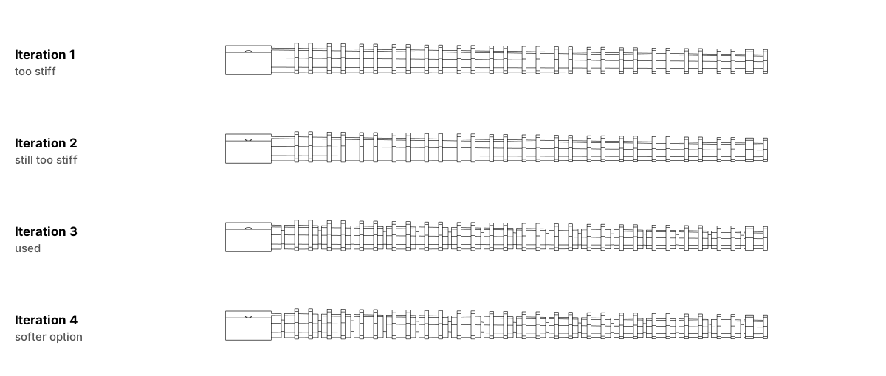
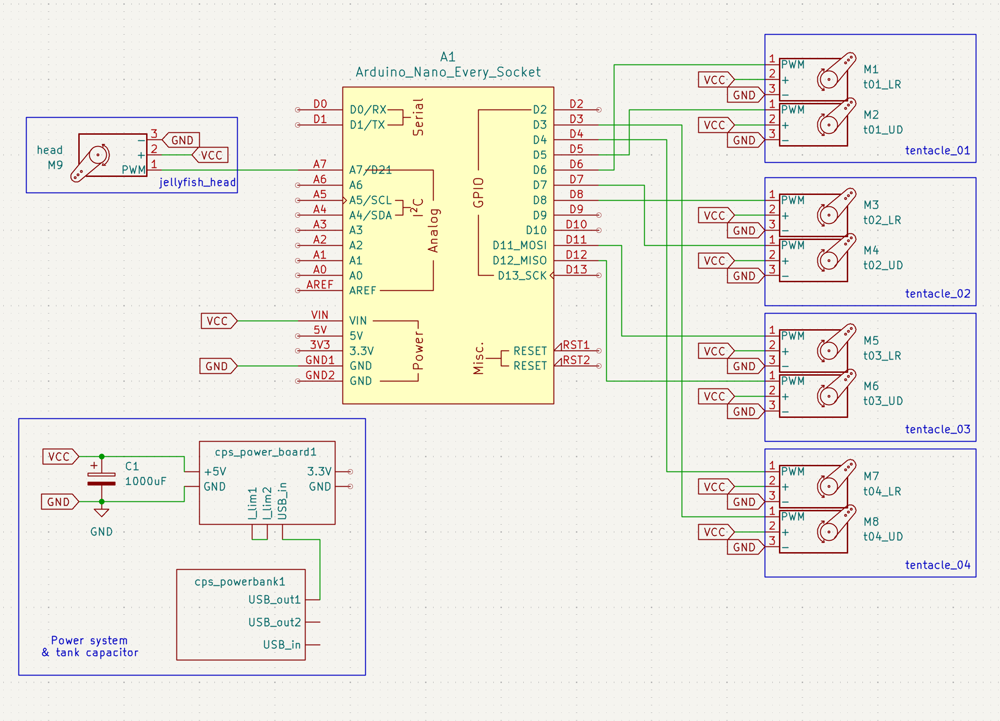
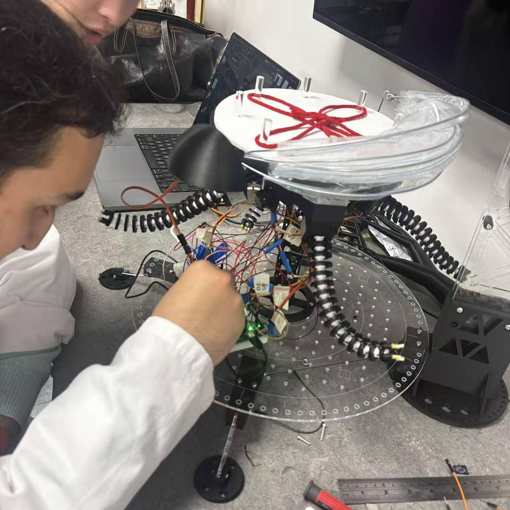
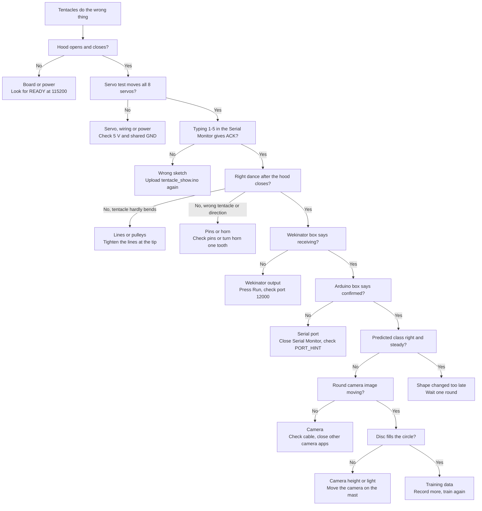

# SPECIMEN51: Cyberphysical Systems

IDE Cyberphysical Systems, Group 11  
Team Members: Ismail Kale, Siyu Sun, Shuheng Wang

# Contents

- [Overview](#overview)
- [Design](#design)
  - [From the robot arm to tentacles](#from-the-robot-arm-to-tentacles)
  - [Assembly drawings](#assembly-drawings)
  - [Files to print and cut](#files-to-print-and-cut)
- [Mechanisms](#mechanisms)
  - [Tentacles](#tentacles)
  - [Body and support](#body-and-support)
  - [Hood](#hood)
- [Electronics](#electronics)
  - [Components](#components)
  - [Circuit diagram](#circuit-diagram)
  - [Power](#power)
  - [Wiring](#wiring)
- [Wekinator](#wekinator)
  - [Input](#input)
  - [Output](#output)
  - [Training and running the model](#training-and-running-the-model)
  - [Testing the model](#testing-the-model)
  - [Improving the model](#improving-the-model)
- [Processing](#processing)
  - [Processing_camera/camera_to_wekinator.pde](#processing_cameracamera_to_wekinatorpde)
  - [Processing_osc_to_arduino/osc_to_arduino.pde](#processing_osc_to_arduinoosc_to_arduinopde)
  - [arduino/tentacle_show.ino](#arduinotentacle_showino)
  - [How to run (macOS)](#how-to-run-macos)
- [Debugging](#debugging)
  - [Decision tree](#decision-tree)
  - [Problems and fixes](#problems-and-fixes)
- [Limitations and Potential Explorations](#limitations-and-potential-explorations)
- [References](#references)
- [AI Disclaimer](#ai-disclaimer)

# Overview

SPECIMEN51 is a soft jellyfish robot. Four tentacles hang from a round black body, and on top there is a clear hood that folds open and shut like the hood of a pram. While the hood is open, you wind a piece of red yarn around the pegs on the white disc to make a shape. A webcam above the robot looks at it and Wekinator decides which of our five shapes it is. Then the hood closes and the tentacles do the dance that belongs to that shape. After the dance the hood opens again for the next person. We set it up like a small surgery, with the jellyfish lying on an operating table under the camera like a specimen being examined. Winding the yarn is like wiring up its nerves: the visitor builds a small circuit on the disc, and the jellyfish answers with a dance.

Demo video: [SPECIMEN51 on YouTube](https://www.youtube.com/shorts/cth6zIek0fg)

We wanted an input that you make with your hands. The yarn stays on the disc, which means the camera can look at it the whole time the hood is open, and winding a new shape (or fixing an old one) only takes a few seconds. Red yarn on a white disc is also easy for the camera to pick out.

The instruction manual shows the five shapes (MODE_1 to MODE_5) and the dance each one triggers. MODE_0 is the rest pose with all tentacles straight.

| Square on the pegs | Triangle under the closing hood |
| --- | --- |
|  |  |

One round lasts 45 s and then starts again: 25 s for the hood (3 s to open, about 19 s open, 3 s to close), 5 s of rest and 15 s of dancing. The class is taken 2 s before the hood starts to close, and the dance starts about 10 s after that.

The display stand is based on an operating table, and the jellyfish lies on it like a specimen being examined. The whole thing is about 66 cm tall and 53 cm wide at the feet, and the robot body sits 23 cm above the deck.

| Running the software next to the exhibit | Front view with the hood closed |
| --- | --- |
|  |  |

# Design

## From the robot arm to tentacles

We kept the software pipeline from the course robot arm exercise (webcam, Wekinator, Processing, Arduino, servos), but replaced the rigid four-joint arm with a soft mechanism. SPECIMEN51 uses nine servos (two per tentacle and one for the hood) so the tentacles can bend in any direction for waves and circles instead of fixed poses.

## Assembly drawings

We drew the whole exhibit on four sheets: an exploded view, a parts list, and 15 assembly steps on the last two. Steps 1-5 are the display stand, 6-9 the robot, 10-14 the hood, and step 15 sets the camera height. Part codes on the parts list: A for acrylic, P for printed stand parts, R for the robot and T for the top. The four sheets are also in one PDF: [SPECIMEN51_assembly.pdf](images/assembly/SPECIMEN51_assembly.pdf).

## Files to print and cut

All the parts we printed or cut are in `cad/`. The codes are the same as on the parts list above. The winding disc, pegs, hood wires and film (T2-T9) are simple shapes without files. Their sizes are on the parts list.

**Robot** (`cad/robot/`, black PLA unless noted)

| Code | Part | Qty | File |
| --- | --- | --- | --- |
| R1 | Chassis, 225 mm | 1 | [R1_chassis.stl](cad/robot/R1_chassis.stl) |
| R2 | Tentacle stand, 30 degrees | 4 | [R2_tentacle_stand.stl](cad/robot/R2_tentacle_stand.stl) |
| R4 | Pulley for horns with a raised hub | 8 in total | [R4_pulley.stl](cad/robot/R4_pulley.stl) |
| R4 | Pulley for flat horns | | [R4_pulley_flat_horn.stl](cad/robot/R4_pulley_flat_horn.stl) |
| R5 | Spine, TPU 90A (iteration 3, on the robot) | 4 | [R5_spine_TPU.stl](cad/robot/R5_spine_TPU.stl) |
| R5 | Softer spine, TPU 90A (iteration 4) | | [R5_spine_TPU_softer.stl](cad/robot/R5_spine_TPU_softer.stl) |
| R5 | Ribs, one set of 15 (26 to 20 mm) | 4 sets | [R5_ribs_set_of_15.stl](cad/robot/R5_ribs_set_of_15.stl) |
| R5 | The same ribs for laser cutting, 5 sets on 3 mm sheet | | [R5_ribs_laser_3mm.dxf](cad/robot/R5_ribs_laser_3mm.dxf) |
| R6 | Line locks, 20 on one plate (4 per tentacle) | 1 plate | [R6_line_locks_x20.stl](cad/robot/R6_line_locks_x20.stl) |
| R6 | Tip head that clamps all four lines with one M3x6 screw (we used the line locks instead) | | [R6_tip_head.stl](cad/robot/R6_tip_head.stl) |

**Display stand** (`cad/display_stand/`, black PLA and 3 mm clear acrylic)

| Code | Part | Qty | File |
| --- | --- | --- | --- |
| A1 | Deck and top sheet, 388 mm | 2 | [A1_deck.dxf](cad/display_stand/A1_deck.dxf) |
| A2 | Leg blade | 3 | [A2_leg_blade.dxf](cad/display_stand/A2_leg_blade.dxf) |
| A3 | Mast plates a and b | 2 | [A3a_mast_plate.dxf](cad/display_stand/A3a_mast_plate.dxf), [A3b_mast_plate.dxf](cad/display_stand/A3b_mast_plate.dxf) |
| A4 | Arm plate | 2 | [A4_arm_plate.dxf](cad/display_stand/A4_arm_plate.dxf) |
| A1-A4 | All of the above on two 600 x 400 sheets (sheet 1 has one deck, so cut A1 once more) | | [laser_sheet_1.dxf](cad/display_stand/laser_sheet_1.dxf), [laser_sheet_2.dxf](cad/display_stand/laser_sheet_2.dxf) |
| P1 | Hip node | 3 | [P1_hip_node.stl](cad/display_stand/P1_hip_node.stl) |
| P2 | Foot | 3 | [P2_foot.stl](cad/display_stand/P2_foot.stl) |
| P3 | Mast pedestal | 1 | [P3_mast_pedestal.stl](cad/display_stand/P3_mast_pedestal.stl) |
| P4 | Mast spacer | 9 | [P4_mast_spacer.stl](cad/display_stand/P4_mast_spacer.stl) |
| P5 | Mast cap | 1 | [P5_mast_cap.stl](cad/display_stand/P5_mast_cap.stl) |
| P6 | Carriage | 1 | [P6_carriage.stl](cad/display_stand/P6_carriage.stl) |
| P7 | Arm spacer | 2 | [P7_arm_spacer.stl](cad/display_stand/P7_arm_spacer.stl) |
| P8 | Camera head | 1 | [P8_camera_head.stl](cad/display_stand/P8_camera_head.stl) |
| P9 | Camera bracket | 1 | [P9_camera_bracket.stl](cad/display_stand/P9_camera_bracket.stl) |
| P10 | Knob | 2 | [P10_knob.stl](cad/display_stand/P10_knob.stl) |
| P11 | Small knob | 1 | [P11_knob_small.stl](cad/display_stand/P11_knob_small.stl) |
| P12 | Centre post | 1 | [P12_centre_post.stl](cad/display_stand/P12_centre_post.stl) |
| P14 | Robot support | 1 | [P14_robot_support.stl](cad/display_stand/P14_robot_support.stl) |
| P15 | Robot cap | 1 | [P15_robot_cap.stl](cad/display_stand/P15_robot_cap.stl) |

**Lid** (`cad/lid/`, T1). These parts we modelled in Onshape:

| Part | File |
| --- | --- |
| Lid ring, 224 mm | [super ring.stl](cad/lid/super%20ring.stl) |
| Lid servo cover (half) | [servo cover half.stl](cad/lid/servo%20cover%20half.stl) |
| Wire holder on the lid servo horn | [servo horn wire holder v2.stl](cad/lid/servo%20horn%20wire%20holder%20v2.stl) |
| Lid servo rail, laser-cut | [servo attachment rail.dxf](cad/lid/servo%20attachment%20rail.dxf) |
| Lid and servo, whole assembly | [lid motor assembly.step](cad/lid/lid%20motor%20assembly.step) |

All STL files are already turned the right way for printing. PLA at 0.2 mm layers, 3 walls, 15% infill, no supports. For the TPU 90A spines, dry the filament first and print slowly (max 2-2.5 mm3/s), with 4 walls and 100% infill, lying flat.

# Mechanisms

## Tentacles

Each tentacle is a soft TPU spine with 15 hard ribs, 10 mm apart, getting smaller from 26 mm at the root to 20 mm at the tip. Four fishing lines (top, bottom, left, right) run through the ribs and are locked at the tip with small printed beads. At the root, each pair of opposite lines goes round the pulley of one servo, and with two servos the tentacle can bend in any direction.

The spine went through four iterations. The first was solid TPU and hardly bent at all. The second had the same outside but closed hollow chambers inside, and it was still too stiff. The third has thin ring slits between the ribs, leaving only a round core, and that's the one on the robot now. The fourth has an even thinner core in case we ever need it softer.

The pulleys changed twice. The first didn't fit the raised hub of our MG90S horns, and we remodelled the pocket around the real horn (plus a version for flat horns). A bigger groove, 12 mm radius instead of 10, then let the tentacle bend all the way. Knots slipped in the fishing line, so each line end goes through a bead with a tapered hole and is wedged with a short bit of 1.75 mm filament.

## Body and support

The four tentacle stands are screwed under a printed chassis 225 mm across. Each holds two servos and points its tentacle 30 degrees down. The robot sits on a thin printed tube (P14) with a cap (P15) and an M4x30 button-head screw, because a socket head touches the lid.

The display stand is two 388 mm clear acrylic discs on three splayed legs. The webcam slides up a mast at the back, and above about 390 mm the closed hood is out of its view.

## Hood

The lid ring, lid servo cover and rail are our own Onshape parts (see `cad/lid/`). On top sits a white disc with eight clear acrylic pegs for the yarn.

The hood is four 1.5 mm steel half-circle wires on one hinge, joined by clear film. The servo swings the outer wire forward, which pulls the others into a closed dome.

The pattern was constructed in onshape as a typical "6-peel ball" pattern, and 3 were cut out of polythene sheet. A long strip of polythene was also folded over and stitched to create a long strip of "casing" (aka. channel). Finally the casing was sandwiched between the edges of two "peel" panels, channel-side out, and stitched together. The result was the 3-segment hemisphere hood, through which steel wire was carefully threaded and bent to shape.

# Electronics

## Components

An Arduino Nano Every drives eight MG90S servos (two per tentacle) and a SF90 servo for the hood. We chose metal-gear MG90S servos because plastic gears can strip when pulling the tentacle lines. The webcam plugs into the laptop.

## Circuit diagram

## Power
As visible in the schematic above, the CPS power board was connected to the CPS power bank, providing the 5V and GND for the system. The two current limit jumpers were also shorted in order to supply the full 2A of current from the power bank, giving us a total power budget of 10W. The GND of the Arduino was tied to the power board GND to avoid floating grounds, but the 5V from the Arduino itself was kept separate from the power board so as to not draw additional power from the laptop USB supply (although as per USB 2.0 spec, it would have [only supplied 500mA so 2.5W extra](https://knowledge.cambrionix.com/Content/Articles/USB/Understanding-USB-Power-Standards.htm?TocPath=Articles%7CUSB%7C_____11) anyway).
## Wiring

# Wekinator

## Input

The input is the yarn shape on the disc, seen from above by the webcam. `camera_to_wekinator.pde` cuts a circle out of the middle of the image that just covers the disc and blacks out everything else. It then samples a 44x44 grid of brightness values (1936 inputs between 0 and 1) and sends them to Wekinator every third frame. 

## Output

One classifier output with five classes, one for each shape. We picked a classifier because every shape should start exactly one dance. With continuous outputs the robot could end up somewhere between two dances.

| Class | Shape | Dance |
| --- | --- | --- |
| 1 | Triangle | Up/down wave: each tentacle rises and falls a quarter beat after the one before, like a wave running round the body |
| 2 | Square | Left/right wave: the same wave, but left and right |
| 3 | Circle | Diagonal twitch: two opposite tentacles twitch quickly, and every 2 s the other pair takes over |
| 4 | Long thin loop | Cross-step: one pair sways left and right in mirror while the other pair nods up and down, with a bigger nod every other bar |
| 5 | Half circle | Relay: one tentacle at a time swings round in a circle, then hands over to the next one |

## Training and running the model

1. Start `camera_to_wekinator.pde` and check that the disc fills the round image.
2. Set up Wekinator with 1936 inputs on port 6448 (`/wek/inputs`) and one classifier output with 5 classes, sent to port 12000 (`/wek/outputs`). Our settings are in `Wekinator/` (`CPS_Wekinator.wekproj`, `inputConfig.xml`, `outputConfig.xml`).
3. Wind the first shape, set the output to class 1 and record examples. Between recordings, move the yarn a little or wind it again, to give the model the same shape in slightly different positions.
4. Do the same for classes 2 to 5, then train.
5. Press Run. The predicted class goes to `osc_to_arduino.pde` and from there to the Arduino.

We recorded about 2,500 examples in total for the five shapes and trained Wekinator's default classifier, k-nearest neighbour.

The trained model isn't in the repository, only the settings. On a new computer, or in different light, it has to be trained again.

## Testing the model

When we tested the trained model, the triangle, the long thin loop and the half circle were classified correctly about 90% of the time. The square and the circle were often mixed up with each other.

## Improving the model

With more time, we would record training data under the actual exhibition lighting and try other Wekinator classifiers (such as SVM or decision trees) or a small CNN for shifted and rotated shapes. We also tried an "empty disc" class, but Wekinator often mistook the other shapes for it, so we dropped it: visitors take the disc off, wind it and put it back. We would like to solve this later. A messy square and a circle still look similar on a 44x44 grid, and a big change in lighting still needs retraining.

# Processing

Two Processing sketches sit between the camera, Wekinator and the Arduino, and one Arduino sketch runs the whole robot. They grew out of the code we used for the robot arm.

## `Processing_camera/camera_to_wekinator.pde`

Opens the webcam, cuts out the round disc and sends a 44x44 grid to Wekinator on port 6448. It is set up for macOS; on Windows, replace `"pipeline:avfvideosrc device-index=0"` in `setup()` with `Capture.list()[0]`. Ignore the class box in the window.

## `Processing_osc_to_arduino/osc_to_arduino.pde`

Takes the class from Wekinator on port 12000 and sends it to the Arduino once it has held for 200 ms, which filters out flickers. The Arduino answers `ACK`, and the window shows what Wekinator sends and whether the Arduino confirmed it. Set `PORT_HINT` to Arduino's port name (`"usbmodem"` on a Mac, e.g. `"COM3"` on Windows).

## `arduino/tentacle_show.ino`

The Arduino goes round three phases:

| Phase | Length | What happens |
| --- | --- | --- |
| 0 Lid | 25 s | The hood opens over 3 s and stays open so a shape can be wound. 2 s before it starts closing, the Arduino takes the latest class. Then the hood closes over 3 s. |
| 1 Rest | 5 s | All tentacles straight, hood closed. |
| 2 Dance | 15 s | The dance for the class taken in phase 0. |

The code also sends a short blue light along an LED strip at every phase change. We planned the strip at the start but ran out of time to fit it. A class that comes in after the pick waits for the next round; this way the closing hood can't change the dance. Over serial the Arduino prints `READY` at start, `phase:n` at each phase change, `animation:n` when it takes the class, `class:n` when a new class comes in and `ACK n` for every message. You can also type a single digit into the Serial Monitor, which is handy for testing without Wekinator.

Only this sketch is needed to run the project.

## How to run (macOS)

1. Install Processing 4 with the Video library (GStreamer) and oscP5, and in the Arduino IDE the Servo and Adafruit NeoPixel libraries. The board is an Arduino Nano Every, which needs the "Arduino megaAVR Boards" package.
2. Open `arduino/tentacle_show.ino`. The Arduino IDE asks to move it into a folder of its own; say yes. Upload it and close the Serial Monitor.
3. Run `Processing_osc_to_arduino/osc_to_arduino.pde`. The "Sent" box should say "serial OK". If it doesn't, change `PORT_HINT` to your Arduino port.
4. Run `Processing_camera/camera_to_wekinator.pde` and check that the yarn shape is inside the round image.
5. Start Wekinator with our settings (see Training and running the model), train and press Run.
6. When the "Arduino" box in `osc_to_arduino` says "confirmed", the class has reached the robot.

# Debugging

Uploading a test sketch replaces the main sketch, so upload `tentacle_show.ino` again after testing.

| Test | What it tells you |
| --- | --- |
| [CPS_Debug_Arduino_servo_test.ino](debug/CPS_Debug_Arduino_servo_test/CPS_Debug_Arduino_servo_test.ino) with [CPS_Debug servo_test.html](debug/CPS_Debug%20servo_test.html) | Whether each of the 8 tentacle servos works. Open the page in Chrome or Edge (it uses Web Serial at 9600 baud) and press a button: that servo turns to 180, then to 0, then switches off. Loosen the lines first, because this is a much bigger swing than the tentacles can take. The lid servo is not part of this test. |
| Serial Monitor with `tentacle_show.ino` (115200, "Newline") | Whether the Arduino gets classes. Type 1 to 5 and look for `ACK n`. |
| The four boxes in `osc_to_arduino.pde` | Where the chain stops: Wekinator, stable class, sent, confirmed by the Arduino. |
| The 44x44 grid in `camera_to_wekinator.pde` | What Wekinator actually sees. |

## Decision tree

## Problems and fixes

| Problem | Cause | Fix |
| --- | --- | --- |
| Pulley doesn't sit on the servo horn | MG90S horns have a raised hub | Pulley pocket shaped around the real horn (see Tentacles) |
| Line ends slip | Knots don't hold in clear fishing line | Printed beads with a filament wedge |
| Tentacle stops short of a full bend | Too little line per degree | 12 mm pulley groove |
| Tentacle hardly bends | Spine too stiff | Spine with ring slits (iteration 3) |
| Servos twitch or stop when many move | Not enough current for all servos at once | Dances move at most four tentacle servos at a time; check the servo supply and the shared ground |
| Tentacle bent when it should be straight | Horn one tooth off | Turn the horn by one tooth so the tentacle is straight at 90 |
| "Sent" box says "serial closed" | Serial Monitor or servo test page has the port open | Close them, or set `PORT_HINT` |
| No `ACK` | Wrong sketch on the board, for example the servo test | Upload `tentacle_show.ino` |
| Prediction jumps between two classes | Shapes too alike, or too few examples | 200 ms filter in `osc_to_arduino`; record more examples |
| Dance doesn't match the shape on the disc | Shape changed after the class was taken | Wait one round |

# Limitations and Potential Explorations

- The MG90S servos are near their torque limit just lifting a tentacle. Stronger servos would let us try walking again.
- We also considered air-driven silicone tentacles, but the pumps and valves don't fit the 5 V course kit.
- Raw brightness values make the model sensitive to shadows and room lighting; a fixed lamp and a simple black-and-white threshold in `camera_to_wekinator` would help a lot.
- The fishing lines stretch over time and need re-tightening at the tip, so a low-stretch braided line would be better.
- On the hardware side, thicker acrylic would stop the camera mast swaying, a slightly smaller deck (360 mm instead of 388 mm) would pack flat in the 370 mm storage box, and the hood film still occasionally catches when pleating between the wires.
- On the electronics side, soldering a veroboard would avoid many breadboard-related connection issues.
- On the software side, `osc_to_arduino` could forward the class to port 12001 for the camera window, the planned LED strip could be fitted and change colour per dance, and the web test page needs a button for the lid servo.

# References

- Fiebrink, R. Wekinator. http://www.wekinator.org/
- Fiebrink, R. Wekinator examples (the Processing webcam example our camera sketch started from). http://www.wekinator.org/examples/
- Processing Foundation. Processing 4 and the Video library. https://processing.org/
- Schlegel, A. oscP5. https://sojamo.de/libraries/oscP5/
- Arduino. Servo library. https://docs.arduino.cc/libraries/servo/
- Adafruit. Adafruit NeoPixel library. https://github.com/adafruit/Adafruit_NeoPixel
- MDN. Web Serial API. https://developer.mozilla.org/en-US/docs/Web/API/Web_Serial_API

# AI Disclaimer

We wrote the original drafts of this README ourselves, and used Claude to polish the English, format parts of the Markdown tables and Mermaid diagrams, and help organize the repository. We also used it to help write and debug parts of the Processing, Arduino, and web-test code. All mechanical design, CAD models, assembly drawings, physical building, and hardware testing on the robot were done by the team.
