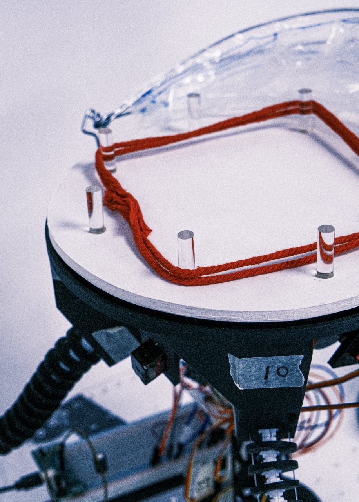
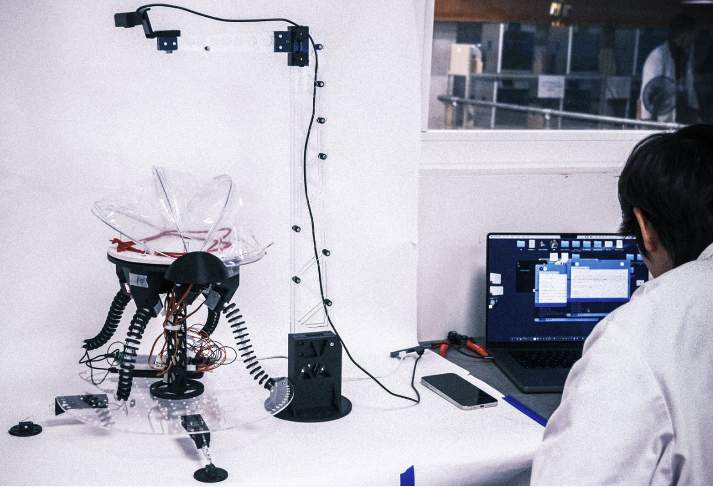
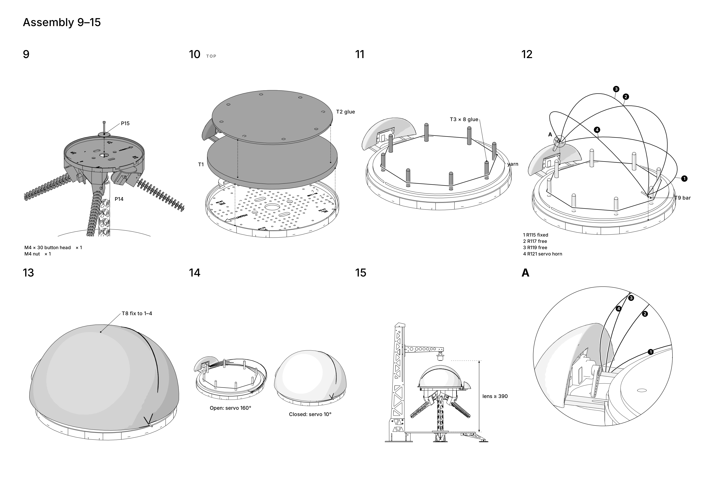
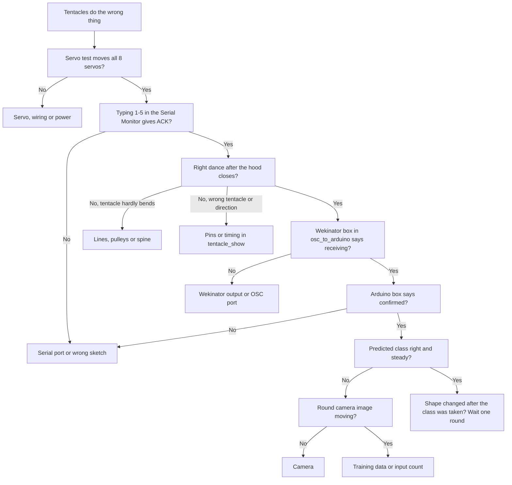

# SPECIMEN51: Cyberphysical Systems

IDE Cyberphysical Systems, Group 11  
Team Members: Ismail Kale, Siyu Sun, Shuheng Wang

# Contents

- [Overview](#overview)
- [Design](#design)
  - [From the robot arm to tentacles](#from-the-robot-arm-to-tentacles)
  - [Assembly drawings](#assembly-drawings)
  - [Files to print and cut](#files-to-print-and-cut)
- [Mechanisms](#mechanisms)
  - [Tentacles](#tentacles)
  - [Body and support](#body-and-support)
  - [Hood](#hood)
- [Electronics](#electronics)
  - [Components](#components)
  - [Circuit diagram](#circuit-diagram)
  - [Power](#power)
  - [Wiring](#wiring)
- [Wekinator](#wekinator)
  - [Input](#input)
  - [Output](#output)
  - [Training and running the model](#training-and-running-the-model)
  - [Improving the model](#improving-the-model)
- [Processing](#processing)
  - [Processing_camera/camera_to_wekinator.pde](#processing_cameracamera_to_wekinatorpde)
  - [Processing_osc_to_arduino/osc_to_arduino.pde](#processing_osc_to_arduinoosc_to_arduinopde)
  - [arduino/tentacle_show.ino](#arduinotentacle_showino)
  - [How to run (macOS)](#how-to-run-macos)
- [Debugging](#debugging)
  - [Decision tree](#decision-tree)
  - [Problems and fixes](#problems-and-fixes)
- [Rejected ideas](#rejected-ideas)
- [Next steps](#next-steps)
- [References](#references)

# Overview

SPECIMEN51 is a soft jellyfish robot. Four tentacles hang from a round black body, and on top there is a clear hood that folds open and shut like the hood of a pram. While the hood is open, you wind a piece of red yarn around the pegs on the white disc to make a shape. A webcam above the robot looks at it and Wekinator decides which of our five shapes it is. Then the hood closes and the tentacles do the dance that belongs to that shape. After the dance the hood opens again for the next person.

We wanted an input that you make with your hands. The yarn stays on the disc, which means the camera can look at it the whole time the hood is open, and winding a new shape (or fixing an old one) only takes a few seconds. Red yarn on a white disc is also easy for the camera to pick out.

The instruction manual shows the five shapes (MODE_1 to MODE_5) and the dance each one triggers. MODE_0 is the rest pose with all tentacles straight.

| Square on the pegs | Triangle under the open hood |
| --- | --- |
|  |  |

One round lasts 45 s and then starts again: 25 s for the hood (3 s to open, about 19 s open, 3 s to close), 5 s of rest and 15 s of dancing. The class is taken 2 s before the hood starts to close, and the dance starts about 10 s after that.

The display stand is based on an operating table, with splayed legs and a truss mast for the camera, and the jellyfish sits on it like a specimen being examined. The printed parts are black PLA. The deck, the stand plates and the hood are all clear, and the robot is what you notice first. The whole thing is about 66 cm tall and 53 cm wide at the feet, and the robot body sits 23 cm above the deck.

| Running the software next to the exhibit | Front view with the hood open |
| --- | --- |
|  |  |

# Design

## From the robot arm to tentacles

The brief starts from the course robot arm. We kept the control chain we had built in the arm exercise: camera, Wekinator, Processing, Arduino, servos. The arm itself we left behind, because a jellyfish doesn't move like a rigid arm. The arm moves four servos, one per joint, to fixed positions. SPECIMEN51 has nine servos, two for each tentacle and one for the hood, and each tentacle bends along its whole length in any direction. That is what lets the dances be waves and circles instead of poses.

## Assembly drawings

We drew the whole exhibit as 15 assembly steps on four sheets: steps 1-5 are the display stand, 6-9 the robot, 10-14 the hood, and step 15 sets the camera height. Part codes on the parts list: A for acrylic, P for printed stand parts, R for the robot and T for the top. The four sheets are also in one PDF: [SPECIMEN51_assembly.pdf](images/assembly/SPECIMEN51_assembly.pdf).

## Files to print and cut

Only the lid parts are in `cad/` so far. We modelled them in Onshape:

| Part | File |
| --- | --- |
| Lid ring, 224 mm | [super ring.stl](cad/super%20ring.stl) |
| Lid servo cover (half) | [servo cover half.stl](cad/servo%20cover%20half.stl) |
| Wire holder on the lid servo horn | [servo horn wire holder v2.stl](cad/servo%20horn%20wire%20holder%20v2.stl) |
| Lid servo rail, laser-cut | [servo attachment rail.dxf](cad/servo%20attachment%20rail.dxf) |
| Lid and servo, whole assembly | [lid motor assembly.step](cad/lid%20motor%20assembly.step) |

Print settings: PLA at 0.2 mm layers, 3 walls, 15% infill, no supports. For the TPU 90A tentacle spines, dry the filament first and print slowly (max 2-2.5 mm3/s), with 4 walls and 100% infill, lying flat.

# Mechanisms

## Tentacles

Each tentacle is a soft TPU spine with 15 hard ribs on it, 10 mm apart. The ribs get smaller towards the tip, from 26 mm across at the root to 20 mm. Four fishing lines run through holes in the ribs (top, bottom, left, right) and are clamped together at the tip with a small M3 screw. At the root, the left and right lines go round a pulley on one servo and the up and down lines round a pulley on the other. Turning a servo shortens one line and lets out the opposite one, and the tentacle curls towards the short side. With both servos moving together it can bend in any direction, which is how the relay dance draws circles. We tested one tentacle on its own before building the other three.

The spine went through four iterations. The first was solid TPU and hardly bent at all. The second had the same outside but closed hollow chambers inside, and it was still too stiff. The third has thin ring slits between the ribs, leaving only a round core, and that's the one on the robot now. The fourth has an even thinner core in case we ever need it softer.

The pulleys went through a few versions too. The first one didn't fit our MG90S horns because they have a raised hub, and we had to remodel the pocket around the real horn (plus a flat version for the servos that came with flat horns). After that the tentacle still didn't bend all the way when the servo hit its end. Making the groove bigger, from 10 mm to 12 mm radius, fixed it, because every degree of servo turn now pulls more line. Knots also kept slipping in the clear fishing line. In the end we printed little beads with a tapered hole: the line goes through and a short bit of 1.75 mm filament is pushed in after it as a wedge.

## Body and support

The four tentacle stands are screwed under a printed chassis 225 mm across. Each stand holds two servos and points its tentacle 30 degrees down. The chassis has a grid of M3 holes, which made it easy to move things around while building, plus holes for the cables. In the middle of the deck the robot sits on a thin printed tube (P14) with a cap (P15) and one M4x30 screw. That screw has to be a button head; a socket head touches the lid.

The display stand is two 3 mm clear acrylic discs (388 mm) on three splayed legs with printed joints. A mast at the back carries a sliding arm for the webcam, adjustable from 250 to 500 mm above the deck. We keep it above about 390 mm, because lower down the closed hood is in the camera's way.

## Hood

The lid ring, the cover for the lid servo and the rail it sits on are our own Onshape parts (see `cad/`). On top of the lid is a white disc with eight clear acrylic pegs for the yarn.

The hood itself is four 1.1 mm steel wires, each bent into a half circle of a slightly different size (radius 115, 117, 119 and 121 mm). They all turn about the same axis across the lid. The smallest one is fixed lying flat at the back, the two middle ones are loose, and the biggest one is attached to the lid servo horn. On the far side the wire ends hook round a short twisted piece of steel wire sticking out of the lid. A clear film is fixed along all four wires. When the servo swings the outer wire forward, the film drags the two loose wires with it and unfolds into a closed dome.

# Electronics

## Components

## Circuit diagram

## Power

## Wiring

# Wekinator

## Input

The input is the yarn shape on the disc, seen from above by the webcam. `camera_to_wekinator.pde` cuts a circle out of the middle of the image that just covers the disc and blacks out everything else. It then samples a 44x44 grid of brightness values (1936 inputs between 0 and 1) and sends them to Wekinator every third frame. For the robot arm we sent the whole 80x80 image (6400 values). Now only the disc goes in, and people moving around the robot don't change the input (a hand over the disc still does).

## Output

One classifier output with five classes, one for each shape. We picked a classifier because every shape should start exactly one dance. With continuous outputs the robot could end up somewhere between two dances.

| Class | Shape | Dance |
| --- | --- | --- |
| 1 | Triangle | Up/down wave: each tentacle rises and falls a quarter beat after the one before, like a wave running round the body |
| 2 | Square | The same wave, but left and right |
| 3 | Circle | Diagonal twitch: two opposite tentacles twitch quickly, and every 2 s the other pair takes over |
| 4 | Long thin loop | Cross-step: one pair sways left and right in mirror while the other pair nods up and down, with a bigger nod every other bar |
| 5 | Half circle | Relay: one tentacle at a time swings round in a circle, then hands over to the next one |

## Training and running the model

1. Start `camera_to_wekinator.pde` and check that the disc fills the round image.
2. Set up Wekinator with 1936 inputs on port 6448 (`/wek/inputs`) and one classifier output with 5 classes, sent to port 12000 (`/wek/outputs`). Our settings are in `Wekinator/` (`CPS_Wekinator.wekproj`, `inputConfig.xml`, `outputConfig.xml`).
3. Wind the first shape, set the output to class 1 and record examples. Between recordings, move the yarn a little or wind it again, to give the model the same shape in slightly different positions.
4. Do the same for classes 2 to 5, then train.
5. Press Run. The predicted class goes to `osc_to_arduino.pde` and from there to the Arduino.

The trained model isn't in the repository, only the settings. On a new computer, or in different light, it has to be trained again.

## Improving the model

If we had more time, we would mostly collect more training data: other people winding the shapes, bigger and smaller shapes in different spots on the pegs, recorded in the rooms where we show it. We would also add a class for an empty disc and half-wound shapes. Right now there are only five classes, and an empty disc is always read as one of them. More data would help most with shapes from people the model has never seen. Wekinator also has other classifiers for this kind of output (k-nearest neighbour, AdaBoost, decision tree, SVM, naive Bayes), and comparing them on the same recordings would be quick. With a lot more data, a small convolutional network trained on the images might cope better with shapes that are moved or turned, but we haven't tried that.

Better data won't fix everything though. The camera only sees brightness from straight above, and a circle and a rounded square look pretty similar from there. Light changes the numbers too, which means retraining in a new room or bringing our own lamp. And the robot only reacts once per round anyway.

# Processing

Two Processing sketches sit between the camera, Wekinator and the Arduino, and one Arduino sketch runs the whole robot. They grew out of the code we used for the robot arm (Rebecca Fiebrink's video example and Becky Stewart's OSC to Arduino example from the course). The main differences:

| | Robot arm | SPECIMEN51 |
| --- | --- | --- |
| Camera input | Brightness grid of the whole image | Brightness grid of the round disc only |
| Wekinator to Arduino | One byte when the class changes | A text line like `C3`, sent once the class is stable and confirmed by the Arduino |
| Arduino | Four arm servos moved with switch cases and for loops | Nine servos and an LED strip in a loop of lid, rest and dance phases, with sine-wave dances |

## `Processing_camera/camera_to_wekinator.pde`

Opens the webcam at 1280x720, cuts out the round middle part and sends the 44x44 grid to Wekinator on port 6448. The window shows the round camera image, the grid Wekinator receives and how many frames have been sent. The camera is opened through GStreamer with `avfvideosrc`, which only works on macOS. There is also a class box in this window, but it stays at "WAITING FOR WEKINATOR": it listens on port 12001 and nothing sends there yet. Read the class in `osc_to_arduino` instead.

## `Processing_osc_to_arduino/osc_to_arduino.pde`

Listens for `/wek/outputs` on port 12000 and rounds the value to a class from 1 to 5. A class has to hold for 200 ms before it is sent, which filters out one-frame flickers. It sends the class as a line of text (`C3`) when it changes and again every second in case the Arduino has restarted, and the Arduino answers `ACK 3`. The window has four boxes: what Wekinator sends, the stable class, the class that was sent, and the class the Arduino confirmed. The sketch finds the Arduino by part of the port name (`PORT_HINT = "usbmodem"` on a Mac, something like `"COM3"` on Windows) and reconnects by itself if the cable comes out.

## `arduino/tentacle_show.ino`

The Arduino goes round three phases:

| Phase | Length | What happens |
| --- | --- | --- |
| 0 Lid | 25 s | The hood opens over 3 s and stays open so a shape can be wound. 2 s before it starts closing, the Arduino takes the latest class. Then the hood closes over 3 s. |
| 1 Rest | 5 s | All tentacles straight, hood closed. |
| 2 Dance | 15 s | The dance for the class taken in phase 0. |

Every phase change sends a short blue light along the LED strip. A class that comes in after the pick waits for the next round; this way the closing hood can't change the dance. Over serial the Arduino prints `READY` at start, `phase:n` at each phase change, `animation:n` when it takes the class, `class:n` when a new class comes in and `ACK n` for every message. You can also type a single digit into the Serial Monitor, which is handy for testing without Wekinator.

Only this sketch is needed to run the project. `arduino/tentacle_animations_new_copy_20261111020022.ino` is an earlier version we kept for reference. Every phase in it lasts 1 s, the class is used the moment it arrives, the lid is on D10 and it talks at 9600 baud, which means it can't talk to `osc_to_arduino`.

## How to run (macOS)

1. Install Processing 4 with the Video library (GStreamer) and oscP5, and in the Arduino IDE the Servo and Adafruit NeoPixel libraries. The board is an Arduino Nano Every, which needs the "Arduino megaAVR Boards" package.
2. Open `arduino/tentacle_show.ino`. The Arduino IDE asks to move it into a folder of its own; say yes. Upload it and close the Serial Monitor.
3. Run `Processing_osc_to_arduino/osc_to_arduino.pde`. The "Sent" box should say "serial OK". If it doesn't, change `PORT_HINT` to your Arduino port.
4. Run `Processing_camera/camera_to_wekinator.pde` and check that the yarn shape is inside the round image.
5. Start Wekinator with our settings (see Training and running the model), train and press Run.
6. When the "Arduino" box in `osc_to_arduino` says "confirmed", the class has reached the robot.

The two sketch folders have different names from the .pde files inside them. Processing 4 reads `sketch.properties` in each folder to find the right file.

# Debugging

Uploading a test sketch replaces the main sketch, so upload `tentacle_show.ino` again after testing.

| Test | What it tells you |
| --- | --- |
| [CPS_Debug_Arduino_servo_test.ino](debug/CPS_Debug_Arduino_servo_test/CPS_Debug_Arduino_servo_test.ino) with [CPS_Debug servo_test.html](debug/CPS_Debug%20servo_test.html) | Whether each of the 8 tentacle servos works. Open the page in Chrome or Edge (it uses Web Serial at 9600 baud) and press a button: that servo turns to 180, then to 0, then switches off. Loosen the lines first, because this is a much bigger swing than the tentacles can take. The lid servo is not part of this test. |
| Serial Monitor with `tentacle_show.ino` (115200, "Newline") | Whether the Arduino gets classes. Type 1 to 5 and look for `ACK n`. |
| The four boxes in `osc_to_arduino.pde` | Where the chain stops: Wekinator, stable class, sent, confirmed by the Arduino. |
| The 44x44 grid in `camera_to_wekinator.pde` | What Wekinator actually sees. |

## Decision tree

## Problems and fixes

| Problem | Cause | Fix |
| --- | --- | --- |
| Pulley doesn't sit on the servo horn | MG90S horns have a raised hub | Pulley pocket shaped around the real horn (see Tentacles) |
| Line ends slip | Knots don't hold in clear fishing line | Printed beads with a filament wedge |
| Tentacle stops short of a full bend | Too little line per degree | 12 mm pulley groove |
| Tentacle hardly bends | Spine too stiff | Spine with ring slits (iteration 3) |
| Servos twitch or stop when many move | Not enough current for all servos at once | Dances move at most four tentacle servos at a time; check the servo supply and the shared ground |
| LED strip and a servo on the same pin | Both on D11 in an early sketch | LED strip moved to D2 |
| Tentacle bent when it should be straight | Horn one tooth off | Turn the horn by one tooth so the tentacle is straight at 90 |
| "Sent" box says "serial closed" | Serial Monitor or servo test page has the port open | Close them, or set `PORT_HINT` |
| No `ACK` | Wrong sketch on the board (servo test or the old 9600 baud one) | Upload `tentacle_show.ino` |
| Prediction jumps between two classes | Shapes too alike, or too few examples | 200 ms filter in `osc_to_arduino`; record more examples |
| Dance doesn't match the shape on the disc | Shape changed after the class was taken | Wait one round |

# Rejected ideas

- Our first plan was a robot that crawls on its tentacles. The MG90S servos could only just bend a tentacle upwards, and carrying the body on top of that wasn't going to work. We put the robot on a support instead, where only the tentacles move.
- Silicone tentacles driven by air would need pumps and valves that aren't in the 5 V kit. Tentacles pulled by lines we could print and put together in a few days.
- Our first tentacle design had two lines and only swept left and right. Two lines can only bend a tentacle in one plane, which is why the final one has four lines and two servos.
- The body started as a wooden disc. We replaced it with a printed chassis with a hole grid, and after that the stands, cables and lid could be mounted without drilling.
- In our earlier sketch every phase lasted 1 s and a new class was used straight away. A hand or the closing hood in front of the camera could change the dance halfway. Now the class is taken once per round, while the hood is still open.

# Next steps

- Add a fixed lamp and a simple black-and-white threshold in `camera_to_wekinator`, to make light and shadows matter less.
- Forward the class from `osc_to_arduino` to port 12001, so the camera window can show it as well.
- Try stronger servos. The MG90S are near their limit when a tentacle bends upwards.
- Use a fishing line that stretches less. Ours has to be tightened again at the tip after a while.
- Make the mast out of thicker acrylic; it sways a little now.
- Make the deck about 360 mm across. At 388 mm it is a bit wider than the 370 mm storage box.
- Stop the film from catching when the hood closes (it pleats between the wires).
- Let the LEDs change with the class, and add a lid servo button to the servo test page.

# References

- Fiebrink, R. Wekinator. http://www.wekinator.org/
- Fiebrink, R. Wekinator examples (the Processing webcam example our camera sketch started from). http://www.wekinator.org/examples/
- Stewart, B. OSC to Arduino example (2022). Course material, Cyberphysical Systems.
- IDE-GID-Cyberphysical-Systems. de-arm, the course robot arm. https://github.com/IDE-GID-Cyberphysical-Systems/de-arm
- Processing Foundation. Processing 4 and the Video library. https://processing.org/
- Schlegel, A. oscP5. https://sojamo.de/libraries/oscP5/
- Arduino. Servo library. https://docs.arduino.cc/libraries/servo/
- Adafruit. Adafruit NeoPixel library. https://github.com/adafruit/Adafruit_NeoPixel
- MDN. Web Serial API. https://developer.mozilla.org/en-US/docs/Web/API/Web_Serial_API
